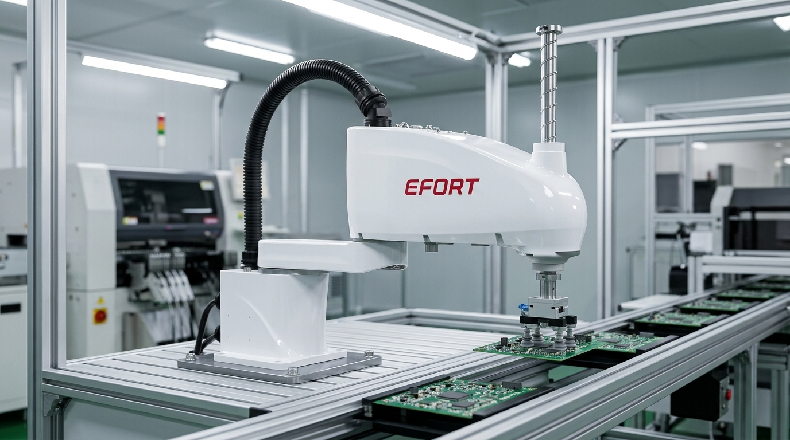
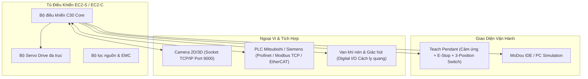
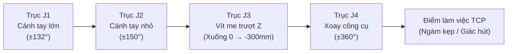
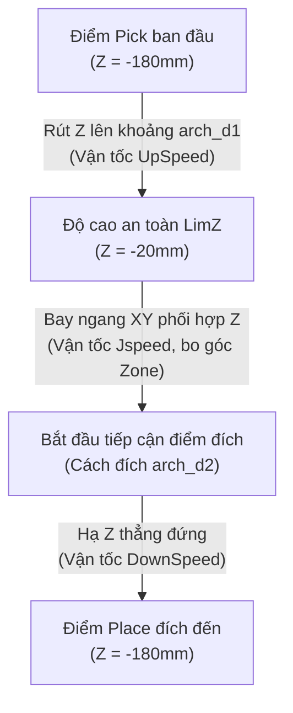

import DownloadBox from "@site/src/components/blog/DownloadBox";

Trong dây chuyền sản xuất tự động hóa hiện đại — đặc biệt là các ngành lắp ráp linh kiện điện tử (3C), sản xuất pin Lithium, kiểm tra PCB và đóng gói dược phẩm — dòng robot **SCARA (Selective Compliance Assembly Robot Arm)** luôn giữ vai trò "xương sống" nhờ ưu thế vượt trội về tốc độ nhịp, độ cứng vững theo phương thẳng đứng và độ lặp lại vị trí cực cao.

Bài viết này mang đến cẩm nang kỹ thuật chuyên sâu về dòng robot **EFORT SCARA (ESR Series)**: từ cấu trúc phần cứng, giải mã quy tắc định danh model, động học 4 trục, quy trình căn chỉnh Zero cơ - điện, cho đến giải phẫu cú pháp lệnh quỹ đạo vòm cổng `JUMPMOVE.Jump`, đoạn mã RPL hoàn chỉnh cho ứng dụng Pick & Place và bảng tra cứu mã lỗi Alarm thực chiến tại nhà máy.

{/* truncate */}

---

## 1. Tổng Quan Phần Cứng & Dòng Sản Phẩm EFORT SCARA (ESR Series)

Dòng robot SCARA của hãng **EFORT Intelligent Robot** được phát triển nhằm đáp ứng các bài toán gắp đặt siêu tốc với nhịp chu kỳ tiêu chuẩn đạt tới **0.33 giây** và độ lặp lại vị trí đạt mức $\pm 0.01\text{ mm}$.



### 1.1 Quy Tắc Định Danh Model (Naming Scheme)

Các kỹ sư khi khảo sát cấu hình trạm máy cần nắm vững cấu trúc mã model chuẩn của hãng để chọn đúng tầm với, tải trọng và môi trường vận hành:

$$\text{ESR [Payload] - [Reach] Z[Stroke] [Environment]}$$

- **Dòng robot (Series):** `ESR` (_EFORT SCARA Robot_ — cấu trúc 4 bậc tự do).
- **Tải trọng danh định (Payload):** `3` (3 kg), `6` (6 kg), `10` (10 kg).
- **Bán kính tầm với tối đa (Arm Reach):** `400` (400 mm), `500` (500 mm), `600` (600 mm), `700` (700 mm), `800` (800 mm).
- **Hành trình trục trượt Z (Z Stroke):** `Z15` (150 mm), `Z20` (200 mm), `Z30` (300 mm), `Z42` (420 mm).
- **Môi trường & Kiểu lắp ráp (Environment):**
  - `S`: Phiên bản tiêu chuẩn lắp sàn (_Standard Floor-mount_).
  - `C`: Phiên bản phòng sạch (_Cleanroom ISO Class 5/6_, thân máy kín áp suất âm).
  - `T`: Phiên bản treo trần (_Ceiling / Suspended Mount_).
  - `P`: Phiên bản chống bụi/nước tăng cường (_High Protection_).

> **Ví dụ điển hình:** Mã `ESR6-500Z20C` định danh cánh tay robot SCARA tải trọng tối đa 6 kg, bán kính với 500 mm, hành trình trục Z đạt 200 mm, đạt chuẩn phòng sạch.

---

### 1.2 Bảng So Sánh Thông Số Kỹ Thuật 3 Dòng Chủ Lực: ESR3, ESR6, ESR10

Dưới đây là bảng ma trận thông số kỹ thuật được trích xuất từ hồ sơ kỹ thuật nhà máy EFORT:

<div className="w-full overflow-x-auto my-6 sm:text-sm text-[10px]">

| Hạng mục thông số                       | Dòng ESR3 (ESR3-400Z15)                                                                         | Dòng ESR6 (ESR6-500/600/700)                                                                        | Dòng ESR10 (ESR10-600/700/800)                                                                          |
| :-------------------------------------- | :---------------------------------------------------------------------------------------------- | :-------------------------------------------------------------------------------------------------- | :------------------------------------------------------------------------------------------------------ |
| **Số bậc tự do**                        | 4 trục ($J_1, J_2, J_3, J_4$)                                                                   | 4 trục ($J_1, J_2, J_3, J_4$)                                                                       | 4 trục ($J_1, J_2, J_3, J_4$)                                                                           |
| **Bán kính tầm với (Reach)**            | 400 mm                                                                                          | 500 / 600 / 700 mm                                                                                  | 600 / 700 / 800 mm                                                                                      |
| **Tải trọng (Định mức / Tối đa)**       | 1 kg / **3 kg**                                                                                 | 2 kg / **6 kg**                                                                                     | 5 kg / **10 kg**                                                                                        |
| **Khối lượng bản thân (Body weight)**   | 12.0 kg (Std) / 12.5 kg (C)                                                                     | 18.0 - 20.7 kg                                                                                      | 22.0 - 25.0 kg                                                                                          |
| **Độ lặp lại vị trí (Repeatability)**   | $J_1+J_2: \pm 0.01\text{ mm}$<br/>$J_3: \pm 0.01\text{ mm}$<br/>$J_4: \pm 0.01^\circ$           | $J_1+J_2: \pm 0.02\text{ mm}$<br/>$J_3: \pm 0.01\text{ mm}$<br/>$J_4: \pm 0.01^\circ$               | $J_1+J_2: \pm 0.02\text{ mm}$<br/>$J_3: \pm 0.01\text{ mm}$<br/>$J_4: \pm 0.01^\circ$                   |
| **Tốc độ vận hành tối đa**              | $J_1+J_2: 7200\text{ mm/s}$<br/>$J_3: 1100\text{ mm/s}$<br/>$J_4: 3000^\circ\text{/s}$          | $J_1+J_2: 7120 - 8590\text{ mm/s}$<br/>$J_3: 1100\text{ mm/s}$<br/>$J_4: 2000^\circ\text{/s}$       | $J_1+J_2: 9100 - 10500\text{ mm/s}$<br/>$J_3: 1500\text{ mm/s}$<br/>$J_4: 2500^\circ\text{/s}$          |
| **Góc quay & Hành trình khớp**          | $J_1: \pm 132^\circ$<br/>$J_2: \pm 145^\circ$<br/>$J_3: 150\text{ mm}$<br/>$J_4: \pm 360^\circ$ | $J_1: \pm 132^\circ$<br/>$J_2: \pm 150^\circ$<br/>$J_3: 200/300\text{ mm}$<br/>$J_4: \pm 360^\circ$ | $J_1: \pm 132^\circ$<br/>$J_2: \pm 150^\circ$<br/>$J_3: 200/300/420\text{ mm}$<br/>$J_4: \pm 360^\circ$ |
| **Chu kỳ nhịp tiêu chuẩn (Cycle Time)** | **0.33 s**                                                                                      | **0.346 s - 0.375 s**                                                                               | **0.340 s - 0.380 s**                                                                                   |
| **Momen quán tính J4 cho phép**         | Max $0.05\text{ kg}\cdot\text{m}^2$                                                             | Max $0.12\text{ kg}\cdot\text{m}^2$                                                                 | Max $0.30\text{ kg}\cdot\text{m}^2$                                                                     |
| **Lực ép hướng trục J3 (Down Force)**   | 100 N                                                                                           | 150 N                                                                                               | **250 N**                                                                                               |

</div>

---

### 1.3 Hệ Thống Điều Khiển & Giao Thức Kết Nối



- **Tủ điều khiển dòng EC2-S:** Thiết kế siêu mỏng dạng Book-size, tối ưu không gian gầm máy tự động, tích hợp bộ xử lý trung tâm C30 và mạch động lực servo đồng bộ.
- **Tay dạy cầm tay (Teach Pendant):** Trang bị màn hình cảm ứng điện dung, nút dừng khẩn E-Stop vật lý và **công tắc kích hoạt 3 vị trí (3-position deadman switch)**. Ở chế độ Manual T1/T2, kỹ sư bắt buộc phải giữ công tắc ở vị trí nấc giữa; thả lỏng hoặc bóp chặt quá mức đều ngắt nguồn động lực ngay lập tức.
- **Cổng giao tiếp truyền thông:**
  - **Digital I/O:** Cổng I/O trên mạch ngắt cách ly quang tốc độ cao (chống nhiễu cuộn coil van khí nén).
  - **Ethernet TCP/IP:** Hỗ trợ giao tiếp socket Client/Server (cổng mặc định 9000), chuyên dùng gửi/nhận dữ liệu tọa độ bù lệch phôi từ hệ thống xử lý ảnh (Machine Vision).
  - **Fieldbus công nghiệp:** Tùy chọn mở rộng card truyền thông Profinet, EtherCAT, Modbus TCP để kết nối PLC chủ.

---

## 2. Cấu Trúc Động Học & 4 Hệ Tọa Độ Làm Việc

Robot SCARA EFORT hoạt động dựa trên cơ cấu 2 cánh tay quay ngang phẳng song song kết hợp một cụm trục vít me bi rãnh trượt (Ball Screw Spline) ở đầu công cụ:



1. **Hệ tọa độ Khớp (Joint Coordinate):** Quản lý trực tiếp góc quay cơ học của 4 khớp động cơ: $J_1(^\circ), J_2(^\circ), J_3(\text{mm}), J_4(^\circ)$.
2. **Hệ tọa độ Chân đế / Thế giới (Base / World Coordinate):** Hệ tọa độ Descartes $(X, Y, Z, R)$ cố định tại tâm đế gắn robot. Chiều $+Z$ hướng thẳng đứng lên trời, mặt phẳng $X\text{-}Y$ nằm ngang.
3. **Hệ tọa độ Công cụ (Tool Frame - TCP):** Điểm thao tác thực tế tại đầu ngàm kẹp. Được định nghĩa qua độ lệch $(X, Y, Z, A, B, C)$ so với mặt bích cơ khí trục $J_4$. Trong code RPL, TCP được khai báo qua hàm `STOOL(...)` cùng thông số tải trọng `LOAD`.
4. **Hệ tọa độ Phôi (User / Workpiece Frame - REFSYS):** Hệ tọa độ tùy biến gắn trên mặt phẳng khay chứa sản phẩm hoặc băng tải, giúp lập trình dịch chuyển ma trận tọa độ dễ dàng mà không làm lệch gốc máy.

---

## 3. Quy Trình Căn Chỉnh Điểm Zero (Zero Calibration)

Khi thay dây curoa truyền động, tháo cụm Ball Screw Spline, thay động cơ servo hoặc gặp sự cố va chạm nghiêm trọng làm trượt vị trí encoder, robot phải được thực hiện hiệu chuẩn Zero qua **2 giai đoạn nghiêm ngặt**:

### Bước 1: Khóa chốt cơ khí & Căn thước đo chuẩn trục Z

1. Xoay thủ công cánh tay $J_1$ và $J_2$ vào vị trí thẳng hàng sao cho vạch dấu cơ khí (Mechanical Alignment Mark) trên vỏ khớp trùng khớp nhau hoàn toàn.
2. Đo và chỉnh độ cao cơ học của trục trượt $J_3$ về giá trị chuẩn $a$ bằng thước kẹp cơ khí theo bảng quy chuẩn nhà máy:
   - **Dòng ESR3 Standard:** Khoảng cách chuẩn $a = 37.5\text{ mm}$.
   - **Dòng ESR6 Standard:** Khoảng cách chuẩn $a = 45.0\text{ mm}$ _(Cleanroom: $82.5\text{ mm}$)_.
   - **Dòng ESR10 Standard:** Khoảng cách chuẩn $a = 47.0\text{ mm}$ _(Cleanroom: $84.5\text{ mm}$)_.

### Bước 2: Nạp dữ liệu CalibData & Cập nhật Encoder trên Teach Pendant

1. Cắm USB chứa file tham số gốc của robot (`CalibData.xml`) vào Teach Pendant.
2. Truy cập ứng dụng **ZeroCalibration** trên màn hình tay dạy.
3. Nhấn **Compute / Calculate** để hệ thống tính toán sai lệch giữa góc encoder thực tế và mô hình hình học. Tiêu chí đạt yêu cầu: `calibration error < 3.0`.
4. Xuất chương trình hiệu chuẩn `ZEROCALIBRATIONHOME.XPL` vào thư mục hệ thống `robot`.
5. Cho chạy chương trình `ZEROCALIBRATIONHOME.XPL` với lệnh `MJOINT(*, v500, fine, tool0, wobj0)` để tủ điều khiển C30 ghi đè giá trị Zero tuyệt đối mới vào bộ nhớ.

---

## 4. Ngôn Ngữ RPL & Các Lệnh Chuyển Động Chuyên Dụng Cho SCARA

Trên nền tảng hệ điều hành **MoDou IDE / C30 Controller**, ngôn ngữ lập trình **RPL** (_Robot Programming Language_) cung cấp các khối dữ liệu cấu trúc chặt chẽ:

- `POINTC`: Tọa độ Descartes $(X, Y, Z, A, B, C, \text{cfgx}, \dots)$.
- `POINTJ`: Tọa độ 4 khớp động cơ $(J_1, J_2, J_3, J_4)$.
- `SPEED`: Khai báo vận tốc tịnh tiến ($\text{mm/s}$) và vận tốc góc ($\text{deg/s}$).
- `ZONE`: Bán kính bo góc mượt mà giữa các điểm chuyển tiếp.
- `TOOL` & `LOAD`: Dữ liệu hình học ngàm kẹp và quán tính tải trọng.

---

### 4.1 Lệnh Nội Suy Khớp `MJOINT`

Lệnh di chuyển đồng bộ cả 4 khớp cùng lúc để đưa đầu TCP đến đích. Đường đi trong không gian là một đường cong tự do.

```c
MJOINT (target, speed, zone, tool, [refsys]);
```

- **Đặc tính:** Thời gian chạy nhanh nhất do động cơ phát huy tối đa công suất mà không cần tính toán đường thẳng. **Tuyệt đối không bao giờ bị lỗi điểm chết (Singularity)**. Rất thích hợp khi di chuyển giữa các trạm ở khoảng cách xa trên cao.

---

### 4.2 Lệnh Nội Suy Đường Thẳng `MLIN`

Đầu TCP tịnh tiến theo một đường thẳng tuyệt đối trong không gian Descartes.

```c
MLIN (target, speed, zone, tool, [refsys]);
```

- **Đặc tính:** Duy trì hướng tiếp cận ổn định, chuyên dùng cho hành trình đi thẳng vào lỗ lắp ráp, rút phôi theo phương thẳng đứng khỏi khuôn cối hoặc chọc linh kiện.

---

### 4.3 "Linh Hồn" Của Robot SCARA: Lệnh Vòm Cổng `JUMPMOVE.Jump`

Để hoàn thành một chu trình gắp nhả kinh điển (Nhấc Z $\rightarrow$ Bay ngang $X\text{-}Y$ $\rightarrow$ Hạ Z), nếu lập trình bằng 3 lệnh `MLIN` riêng lẻ thì các khớp phải gia tốc/giảm tốc 3 lần, làm thời gian nhịp bị đội lên hơn $0.7\text{s}$.

Lệnh **`JUMPMOVE.Jump`** hòa trộn 3 chuyển động này thành một đường cong vòm cổng mượt mà (Gate Motion / Arch Motion), rút ngắn thời gian nhịp xuống dưới **$0.35\text{s}$**:

```pascal
res := JUMPMOVE.Jump(TargetPoint, LimZ, arch_d1, arch_d2, UpSpeed, Jspeed, DownSpeed, Tool, Zone);
```



#### Phân Tích Chi Tiết Các Tham Số:

1. **`TargetPoint` (`POINTC`):** Tọa độ điểm đích đến.
2. **`LimZ` (`REAL`):** Cao độ trần Z an toàn tối đa (tính theo hệ Base). Trục Z phải rút lên vượt qua độ cao này trước khi các khớp quay ngang $J_1, J_2$ được phép vung rộng, tránh va quẹt thành khay chứa.
3. **`arch_d1` (`REAL`):** Đoạn hành trình nhấc thẳng đứng trục Z tại điểm xuất phát trước khi bắt đầu bẻ cong quỹ đạo (_Rise Distance_).
4. **`arch_d2` (`REAL`):** Đoạn hành trình hạ thẳng đứng trục Z tại điểm đích đến (_Descent Distance_).
5. **`UpSpeed` / `Jspeed` / `DownSpeed` (`SPEED`):** Cho phép đặt 3 cấp vận tốc riêng biệt cho 3 pha (Nhấc lên - Bay ngang - Hạ xuống), giúp bảo vệ phôi mỏng manh khi tiếp xúc nhưng vẫn tối đa hóa vận tốc bay giữa không trung.
6. **`res` (`DINT`):** Mã trả về từ bộ điều khiển (`1`: Thành công, `-1`: Thất bại/Lỗi quỹ đạo).

---

### 4.4 Lệnh Di Chuyển Dò Cảm Biến Tuyến Tính `SLINB`

```pascal
SLINB(target, speed, zone, tool, refsys, varpos, boolvar, edge, stopmode, enerr, encheckinit);
```

Cho phép robot lao thẳng về phía `target` với vận tốc đều. Ngay khi cảm biến phát hiện mép sản phẩm `boolvar` (ví dụ `io.DIn[1]`) chuyển trạng thái sang `Rise`, robot lập tức chốt tọa độ tiếp xúc vào biến `varpos`, kích hoạt phanh ngắt `stopmode = Abort` và chuyển sang dòng lệnh kế tiếp mà không bị trượt bước.

---

## 5. Dự Án Thực Tế: Đoạn Mã RPL Hoàn Chỉnh Cho Chu Trình Pick & Place

Dưới đây là đoạn mã RPL tiêu chuẩn công nghiệp phục vụ trạm gắp đặt phôi tự động giữa hai vị trí: có tích hợp rút Z an toàn khi khởi động máy, kiểm tra bắt tay cảm biến kẹp chặt và bẫy lỗi Timeout chống treo máy.

```pascal
MODULE PickAndPlace_Demo

// =========================================================================
// 1. KHAI BÁO BIẾN DỮ LIỆU
// =========================================================================
POINTC p_Home;          // Vị trí gốc an toàn
POINTC p_Pick;          // Vị trí gắp phôi tại Trạm 1
POINTC p_Place;         // Vị trí thả phôi tại Trạm 2
POINTC p_Current;       // Tọa độ đọc tức thời

SPEED v_Fast;           // Tốc độ bay nhanh
SPEED v_Slow;           // Tốc độ tiếp cận êm
ZONE z_Gate;            // Bo góc vòm cổng
ZONE z_Fine;            // Dừng chính xác tuyệt đối

TOOL t_Gripper;         // Khai báo công cụ tay kẹp
LOAD l_Workpiece;       // Khai báo tải trọng phôi

DINT resJump;           // Biến nhận kết quả lệnh Jump
DINT waitStatus;        // Biến kiểm tra mã lỗi Timeout

// =========================================================================
// 2. CHƯƠNG TRÌNH ĐIỀU KHIỂN CHÍNH (PROC MAIN)
// =========================================================================
PROC Main()

    // --- BƯỚC 2.1: KHỞI TẠO TOOL & TẢI TRỌNG ---
    // Khai báo phôi nặng 1.2 kg, trọng tâm lệch Z 15mm
    l_Workpiece := PAYLOAD(1.2, VECT3(0, 0, 15), VECT3(0, 0, 0), VECT3(0.01, 0.01, 0.01));

    // Gán thông số Tool kẹp: chiều dài 80mm dọc trục Z
    t_Gripper := STOOL(0, 0, 80, 0, 0, 0, l_Workpiece);

    // Thiết lập bảng vận tốc: Bay 800 mm/s, Tiếp cận 150 mm/s
    v_Fast := SSPEED(800, 180);
    v_Slow := SSPEED(150, 40);

    z_Gate := SZONE(50, 30);
    z_Fine := fine;

    // Gán tọa độ các điểm trạm máy
    p_Home  := POINTC(350.0,   0.0,  -20.0,  0.0, 0.0, 0.0, CFG1, 0, 0, 0);
    p_Pick  := POINTC(450.0, 150.0, -180.0,  0.0, 0.0, 0.0, CFG1, 0, 0, 0);
    p_Place := POINTC(200.0, -300.0,-180.0, 45.0, 0.0, 0.0, CFG1, 0, 0, 0);

    // --- BƯỚC 2.2: RÚT TRỤC Z AN TOÀN KHI KHỞI ĐỘNG MÁY ---
    MESSAGE("Đang kiểm tra trạng thái khởi động...");
    p_Current := POSC(wobj0);

    // Ép rút Z thẳng lên độ cao -20mm trước khi cho tay đòn xoay về Home
    resJump := JUMPMOVE.Jump(p_Home, -20.0, 50.0, 50.0, v_Fast, v_Fast, v_Fast, t_Gripper, z_Fine);
    IF resJump <> 1 THEN
        ERROR(5001, "Lỗi: Không thể rút trục Z về vị trí Home an toàn!", 0);
        RETURN;
    END_IF;

    MESSAGE("Robot đã vào vị trí Home. Sẵn sàng nhận lệnh chu trình.");

    // --- BƯỚC 2.3: VÒNG LẶP SẢN XUẤT TỰ ĐỘNG ---
    WHILE true DO

        // 1. Chờ tín hiệu báo có phôi từ cảm biến Trạm 1 (DI[1] = ON) trong tối đa 15s
        WAIT(io.DIn[1] = true, 15.0, waitStatus);

        IF waitStatus <> 0 THEN
            MESSAGE("Cảnh báo: Hết thời gian chờ phôi Trạm 1. Tiếp tục đợi...");
            DWELL(1.0);

        ELSE
            MESSAGE("Phát hiện phôi. Bắt đầu quỹ đạo gắp JUMPMOVE...");

            // 2. Chạy vòm cổng tiếp cận điểm gắp phôi
            resJump := JUMPMOVE.Jump(p_Pick, -20.0, 60.0, 30.0, v_Fast, v_Fast, v_Slow, t_Gripper, z_Fine);

            // 3. Kích hoạt van khí nén đóng ngàm kẹp (DO[1] = ON)
            io.DOut[1] := true;
            DWELL(0.2); // Chờ 0.2s cho áp suất khí nén đóng kín

            // 4. Kiểm tra cảm biến kẹp chặt phôi (DI[2] = ON) trong 3 giây
            WAIT(io.DIn[2] = true, 3.0, waitStatus);
            IF waitStatus <> 0 THEN
                io.DOut[1] := false; // Nhả kẹp khẩn cấp
                ERROR(5002, "Sự cố: Cảm biến kẹp phôi không phản hồi!", 0);
                RETURN;
            END_IF;

            // 5. Vận chuyển phôi sang Trạm 2 bằng chuyển động vòm cổng
            MESSAGE("Kẹp phôi hoàn tất. Đang chuyển sang Trạm 2...");
            resJump := JUMPMOVE.Jump(p_Place, -20.0, 40.0, 40.0, v_Fast, v_Fast, v_Slow, t_Gripper, z_Fine);

            // 6. Nhả kẹp phôi tại Trạm 2
            io.DOut[1] := false; // Tắt van kẹp
            DWELL(0.2);          // Chờ áp suất xả hết

            // 7. Rút Z lên và quay về vị trí Home chuẩn bị chu kỳ mới
            resJump := JUMPMOVE.Jump(p_Home, -20.0, 50.0, 50.0, v_Fast, v_Fast, v_Fast, t_Gripper, z_Gate);
            MESSAGE("Hoàn thành chu trình Pick & Place.");

        END_IF;

    END_WHILE;

ENDPROC
ENDMODULE
```

---

## 6. Điểm Chết Khuỷu Tay (Singularity) & Cẩm Nang Xử Lý Sự Cố (Troubleshooting)

### 6.1 Giải Phẫu Điểm Chết Khuỷu Tay (Elbow Singularity) Trên Robot SCARA

Khác với robot 6 trục có nhiều vùng suy biến phức tạp (Wrist, Elbow, Shoulder), cấu trúc cơ học của robot SCARA 4 trục chỉ có **duy nhất 1 điểm chết là Điểm chết khuỷu tay (Elbow Singularity)**:


- **Nguyên nhân:** Khi góc khớp số 2 trở về $0^\circ$ ($J_2 = 0^\circ$), hai cánh tay $J_1$ và $J_2$ tạo thành một đường thẳng tắp duỗi hết tầm với. Tại tư thế này, ma trận chuyển đổi Jacobian mất hạng (định thức $|J| = 0$), khiến vận tốc góc lý thuyết của khớp $J_2$ tiến đến vô hạn nếu tiếp tục bắt robot đi thẳng `MLIN` xuyên qua điểm đó.
- **Cách phòng tránh & Xử lý:**
  1. **Khi lập trình quỹ đạo:** Thay vì dùng `MLIN`, hãy sử dụng **`MJOINT`** cho các đoạn chuyển động dài đi ngang qua vùng bán kính xa nhất.
  2. **Bật chế độ lách điểm chết:** Chèn câu lệnh hệ thống `WRISTMODE(WristJoint)` trước câu lệnh di chuyển để bộ giải nghiệm động học tự động bẻ hướng né điểm chết.
  3. **Thao tác giải cứu khi robot bị khóa cứng:** Nếu đang Jog tay bằng tọa độ Descartes ($X, Y, Z$) mà bị treo máy do dính điểm chết, **tuyệt đối không cố Jog tiếp theo Descartes**. Hãy chuyển hệ tọa độ trên Teach Pendant sang **Khớp (Joint)**, sau đó bấm xoay riêng khớp $J_2$ lệch khỏi góc $0^\circ$.

---

### 6.2 Bảng Tra Cứu Mã Alarm Thực Chiến & Cách Xử Lý

<div className="my-6 w-full overflow-x-auto text-[10px] sm:text-sm">

| Mã Lỗi (Alarm Code)          | Tên Lỗi & Hiện Tượng                                                              | Nguyên Nhân Gốc Rễ                                                                               | Quy Trình Xử Lý Nhanh Tại Hiện Trường                                                                                                                                                                                                                                                                                 |
| :--------------------------- | :-------------------------------------------------------------------------------- | :----------------------------------------------------------------------------------------------- | :-------------------------------------------------------------------------------------------------------------------------------------------------------------------------------------------------------------------------------------------------------------------------------------------------------------------- |
| **Alarm 1068 / 1437**        | **Negative Soft Limit**<br/>(Vượt cữ hành trình mềm âm)                           | Giá trị vị trí thực tế vượt quá ngưỡng cữ giới hạn âm cài đặt trong tham số trục.                | 1. Chuyển sang chế độ Manual Jog theo hệ tọa độ **Khớp (Joint)**, nhấn nút đưa trục ngược lại vào trong không gian làm việc.<br/>2. Kiểm tra lại giá trị tọa độ điểm đích trong chương trình code.<br/>3. Hiệu chỉnh tham số cữ mềm `0x2000` nếu đổi đồ gá mới.                                                       |
| **Alarm 1067 / 1436 / 1514** | **Positive Soft Limit**<br/>(Vượt cữ hành trình mềm dương)                        | Trục di chuyển vượt ngưỡng dương (đặc biệt hay gặp khi trục Z rút lên chạm đỉnh hành trình).     | 1. Chuyển sang Joint Jog, điều khiển trục $J_3$ đi xuống.<br/>2. Kiểm tra tham số `LimZ` hoặc khoảng nâng `arch_d1` trong lệnh `JUMPMOVE` có lớn hơn giới hạn hành trình cơ học trục Z hay không.                                                                                                                     |
| **Alarm 1338 / 3981 / 3944** | **Collision Detect / Joint Torque Limit**<br/>(Phát hiện va chạm / Quá tải momen) | Momen tải động cơ (nhất là trục $J_3$ hoặc $J_4$) tăng vọt vượt ngưỡng an toàn cài đặt.          | 1. Kiểm tra kẹt cơ khí, dị vật cản trở trên trục vít me Ball Screw.<br/>2. Kiểm tra lại khối lượng (`Mass`) và tâm tải trong hàm `PAYLOAD`. Cài đặt thiếu tải trọng khiến bộ điều khiển bù sai dòng điện dẫn đến báo va chạm giả.<br/>3. Giảm độ nhạy `Sensitivity` trong ứng dụng an toàn nếu đang tăng tốc cực đại. |
| **Alarm 1884**               | **Digital Output Forced State**<br/>(Tín hiệu DO bị ép cưỡng bức)                 | Cổng đầu ra điều khiển van khí nén bị người vận hành ghim cưỡng bức ở trạng thái Manual.         | Vào menu **IO Monitor** trên Teach Pendant, duyệt tìm cổng DO đang bị ghim (có ký hiệu Force) và chọn **Cancel Forced State**.                                                                                                                                                                                        |
| **Alarm 1028 / 1418**        | **DC Bus Overvoltage**<br/>(Quá áp thanh cái Bus DC)                              | Điện áp nguồn dao động cao hoặc năng lượng hãm tái sinh khi giảm tốc đột ngột quá lớn.           | 1. Đo kiểm tra nguồn cấp 3 pha/1 pha vào tủ điện EC2-S.<br/>2. Tăng thời gian giảm tốc trong câu lệnh di chuyển hoặc giảm tỷ lệ gia tốc `Acc`.<br/>3. Kiểm tra thông mạch và trị số điện trở xả phanh tái sinh (Braking Resistor).                                                                                    |
| **Alarm 1543**               | **Emergency Stop Triggered**<br/>(Kích hoạt dừng khẩn cấp)                        | Nút bấm E-Stop trên Teach Pendant hoặc nút dừng khẩn tủ máy đang bị nhấn, hoặc đứt mạch an toàn. | 1. Kiểm tra xoay nhả tất cả các nút E-Stop trên Teach Pendant và tủ điện.<br/>2. Đo thông mạch hai kênh kép an toàn $24\text{V}$ trên domino mạch an toàn tủ EC2.                                                                                                                                                     |

</div>

---

### 6.3 Quy Chuẩn Vận Hành An Toàn Nhà Máy

1. **Khởi động nguồn máy:** Đảm bảo không có người đứng trong bán kính quét toàn phần của robot ($400\text{ mm} \div 800\text{ mm}$). Kiểm tra áp suất khí nén cấp cho ngàm kẹp đạt từ **$0.4 \div 0.6\text{ MPa}$**.
2. **Thao tác Dạy điểm bằng tay (Manual Mode - T1):**
   - Cầm Teach Pendant bằng 2 tay chắc chắn, chỉ duy trì công tắc an toàn 3 vị trí ở **vị trí nhấn giữa**.
   - Tốc độ chạy thử nghiệm T1 bị giới hạn cưỡng bức không được vượt quá **$250\text{ mm/s}$**.
3. **Chuyển chế độ Chạy tự động (Auto Mode):** Đưa tay dạy ra ngoài rào chắn bảo vệ, đóng khóa liên động cửa an toàn (Safety Door Interlock), kiểm tra không còn thông báo lỗi trên màn hình trước khi nhấn nút kích hoạt chạy máy từ tủ điều khiển hoặc PLC chủ.

---

## 7. Tổng Kết & Tài Liệu Kỹ Thuật

Dòng robot **EFORT SCARA (ESR Series)** kết hợp cùng bộ điều khiển C30 và ngôn ngữ RPL mang đến một giải pháp tự động hóa gắp đặt và lắp ráp cực kỳ kinh tế, mạnh mẽ và tốc độ cao. Việc nắm vững cách khai báo tải trọng `PAYLOAD`, ứng dụng thuần thục lệnh vòm cổng `JUMPMOVE.Jump`, cơ chế rút Z an toàn khi khởi động và phương pháp xử lý điểm chết khuỷu tay sẽ giúp các kỹ sư tự động hóa tối ưu triệt để năng suất và độ bền cơ khí cho trạm máy.

<DownloadBox
  headerTitle="Tài liệu & Phần mềm liên quan đến Robot EFORT"
  headerDescription="Tài liệu tra cứu chi tiết và phần mềm lập trình chính hãng:"
  items={[
    {
      title: "Cẩm Nang Tra Cứu Cú Pháp EFORT RPL",
      size: "24.1 MB",
      type: "pdf",
      url: "https://drive.google.com/file/d/1corQKD30my6UZ7AcIDVaLSWoancibGaC/view?usp=sharing",
      buttonText: "Tải file PDF",
    },
    {
      title: "Tài liệu tổng hợp các lệnh RPL",
      description: "Tài liệu tra cứu toàn diện tập lệnh RPL của Robot EFORT",
      size: "9 MB",
      type: "pdf",
      url: "https://drive.google.com/file/d/1hyex5EnaJEglsSzLt7pi0U6nMrix6z-J/view?usp=sharing",
      buttonText: "Tải file PDF",
    },
    {
      title: "Phần mềm mô phỏng V392_Virtual",
      size: "73.1 MB",
      type: "zip",
      url: "https://drive.google.com/file/d/1w0IF2vztHDdbwc9mTpbklFiHvRle4sKC/view?usp=sharing",
      buttonText: "Tải file ZIP",
    },
    {
      title: "Phần mềm Openmind Robotics · MoDou IDE",
      description:
        "Môi trường phát triển, lập trình và mô phỏng chính thức của EFORT",
      size: "Online",
      type: "code",
      url: "https://ide.efort.com.cn/en/",
      buttonText: "Truy cập MoDou IDE",
      hideIcon: true,
    },
  ]}
/>
