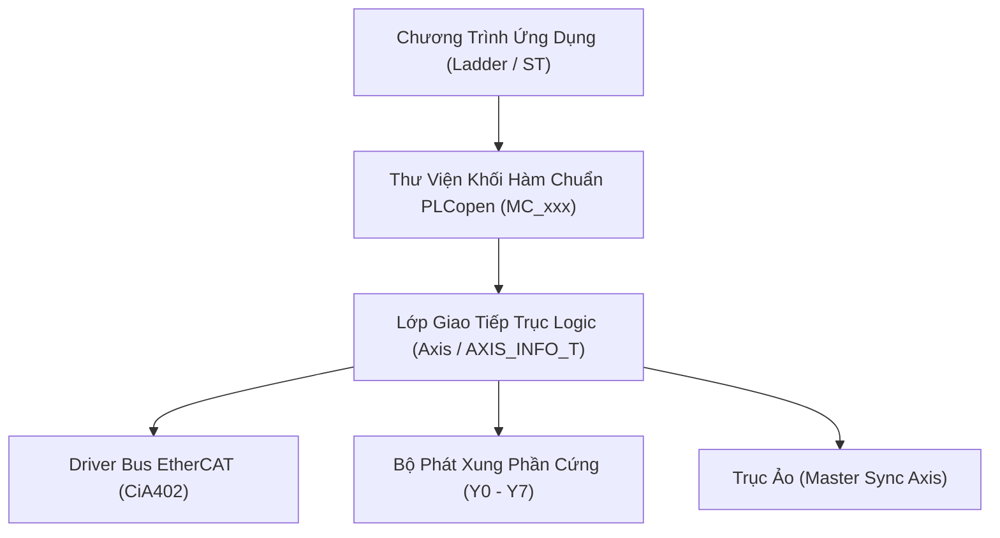
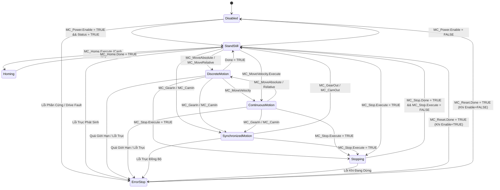
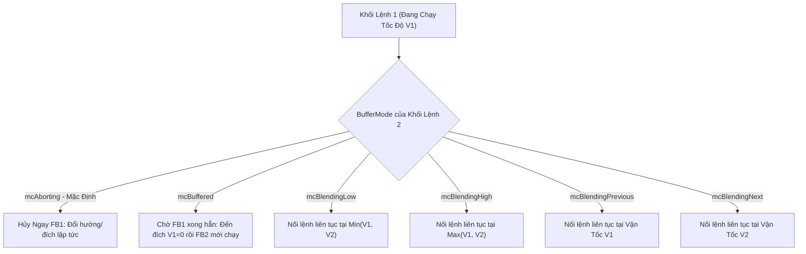
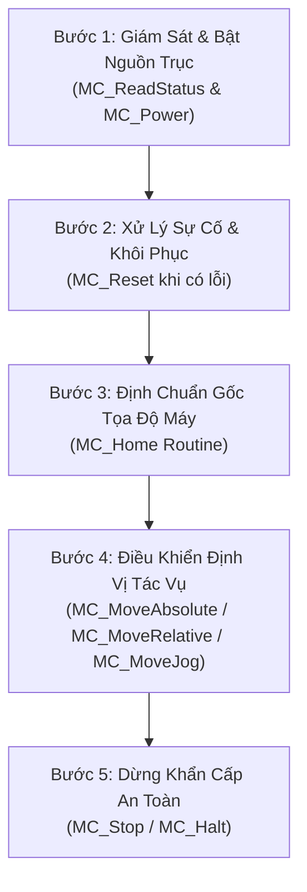

# GIÁO TRÌNH KỸ THUẬT: ĐIỀU KHIỂN CHUYỂN ĐỘNG (MOTION CONTROL) TRÊN PLC WECON DÒNG LX6V / LX6A (PLC EDITOR 2)

> **Mục đích tài liệu:** Tài liệu được biên soạn phục vụ công tác giảng dạy, nghiên cứu chuyên sâu và chuyển giao công nghệ tự động hóa. Nội dung chuẩn hóa 100% theo tài liệu kỹ thuật gốc của nhà sản xuất WECON (Chương 08 Motion Control - PLC Editor 2 cho dòng LX6A / LX6V).

---

## MỤC LỤC TỔNG QUAN

1. [Chương 1: Kiến Trúc Motion Control & Mô Hình Trạng Thái PLCopen](#chuong-1)
2. [Chương 2: Khối Hàm Quản Trị Trục Đơn (8.01 Management FBs)](#chuong-2)
3. [Chương 3: Khối Hàm Chuyển Động Trục Đơn (8.02 Motion FBs)](#chuong-3)
4. [Chương 4: Quản Lý & Điều Khiển Đa Trục - Cam & Gear Điện Tử (8.03 & 8.04)](#chuong-4)
5. [Chương 5: Quản Trị & Nội Suy Nhóm Trục - Axis Group (8.05 & 8.06)](#chuong-5)
6. [Chương 6: Các Khối Hàm Đặc Biệt (8.07 Other Special FBs)](#chuong-6)
7. [Chương 7: Lệnh Đọc/Ghi Tham Số Truyền Thông SDO (8.08 SDO Instructions)](#chuong-7)
8. [Chương 8: Biến Hệ Thống Tích Hợp Của Trục Xung (8.09 Built-in Variables)](#chuong-8)
9. [Chương 9: Cơ Chế Đệm (BufferMode), Nội Suy Cung Tròn & Chuyển Tiếp (8.10 Others)](#chuong-9)
10. [Chương 10: Bảng Tra Cứu & Chẩn Đoán Mã Lỗi (8.11 Error Codes)](#chuong-10)
11. [Chương 11: Khung Chương Trình Chuẩn (Standard Sequence) Phục Vụ Giảng Dạy](#chuong-11)

---


## CHƯƠNG 1: KIẾN TRÚC MOTION CONTROL & MÔ HÌNH TRẠNG THÁI PLCOPEN

### 1.1. Kiến Trúc Trục Logic (Logical Axis Concept)
Trong môi trường WECON PLC Editor 2, hệ thống điều khiển vị trí không can thiệp trực tiếp vào phần cứng vật lý ở tầng dưới cùng mà quản lý thông qua khái niệm **Trục Logic (Axis Reference)**:
- **Trục Bus EtherCAT (CiA402 Profile):** Kết nối Servo thông qua mạng truyền thông thời gian thực EtherCAT.
- **Trục Phát Xung Nội Bộ (Local Pulse Axis):** Sử dụng các ngõ ra transistor tốc độ cao tích hợp trên CPU PLC (Y0/Y1: ID 0, Y2/Y3: ID 1, Y4/Y5: ID 2, Y6/Y7: ID 3).
- **Trục Ảo (Virtual Axis):** Trục không liên kết phần cứng vật lý, thường dùng làm Trục Chủ (Master Axis) cho cấu hình Cam hoặc Gear điện tử.



### 1.2. Mô Hình Trạng Thái Trục Đơn (Single-Axis State Machine)
Mọi hành vi chuyển động của từng trục phải tuân thủ nghiêm ngặt biểu đồ trạng thái chuẩn PLCopen Part 1/Part 2 do WECON định nghĩa:



> [!IMPORTANT]
> **Quy tắc sư phạm cốt lõi khi giảng dạy:**
> 1. Trục chỉ có thể nhận lệnh chuyển động (`MC_Move...`, `MC_Home`) khi đang ở trạng thái **StandStill**.
> 2. Khi đang ở trạng thái **Stopping**, trục bị khóa hoàn toàn, mọi lệnh chuyển động khác đều bị từ chối cho đến khi `MC_Stop.Done = TRUE` **VÀ** tín hiệu `MC_Stop.Execute` hạ xuống mức `FALSE`.
> 3. Khi trục rơi vào **ErrorStop**, việc duy nhất cần làm là khắc phục nguyên nhân sự cố rồi kích hoạt `MC_Reset`.

---


## CHƯƠNG 2: KHỐI HÀM QUẢN TRỊ TRỤC ĐƠN (8.01 SINGLE-AXIS MANAGEMENT FBS)

Nhóm khối hàm này không trực tiếp sinh ra quỹ đạo chuyển động vật lý mà dùng để cấp nguồn, giám sát, cài đặt vị trí và bắt tín hiệu ngoại vi.

### 2.1. Danh Sách Các Khối Quản Trị
1. **MC_POWER:** Bật/Tắt nguồn phần mềm cho servo/bộ điều khiển trục.
2. **MC_READSTATUS:** Đọc trạng thái hoạt động chuẩn PLCopen của trục.
3. **MC_READMOTIONSTATE:** Đọc trạng thái động học (gia tốc, hãm tốc, tốc độ đều, chiều quay).
4. **MC_READAXISERROR:** Đọc cờ báo lỗi và mã lỗi chi tiết của trục.
5. **MC_READAXISINFO:** Đọc thông tin cấu hình phần cứng của trục.
6. **MC_READPARAMETER:** Đọc giá trị thông số kiểu số thực (LREAL).
7. **MC_READBOOLPARAMETER:** Đọc giá trị thông số kiểu logic (BOOL).
8. **MC_READACTUALVELOCITY:** Đọc vận tốc thực tế hiện tại của trục.
9. **MC_READACTUALPOSITION:** Đọc vị trí thực tế hiện tại của trục.
10. **MC_RESET:** Reset lỗi phần mềm và giải phóng trạng thái ErrorStop.
11. **MC_SETPOSITION:** Cài đặt lại vị trí hiện tại (Zero Offset / Calib vị trí).
12. **MC_TouchProbe:** Bắt vị trí trục tức thời theo ngõ vào cảm biến ngoài cực nhanh.
13. **MC_AbortTrigger:** Hủy bỏ tác vụ bắt vị trí của TouchProbe.

---

### 2.2. Chi Tiết Thông Số Kỹ Thuật Từng Khối Hàm

#### 1. MC_POWER (Cấp Nguồn Trục)
*Mục đích:* Công tắc phần mềm điều khiển Servo ON (Ready) cho trục.
- **Đầu vào (VAR_INPUT):**
  - `Enable` (BOOL): Mức logic `TRUE` duy trì cấp nguồn cho drive. Khi `FALSE`, trục chuyển về `Disabled`.
  - `EnablePositive` (BOOL): Cho phép trục quay theo chiều thuận.
  - `EnableNegative` (BOOL): Cho phép trục quay theo chiều nghịch.
- **Đầu vào/ra (VAR_IN_OUT):**
  - `Axis` (WORD / AXIS_REF): Số thứ tự trục (ID: 0 đến 65535).
- **Đầu ra (VAR_OUTPUT):**
  - `Status` (BOOL): Trạng thái đóng nguồn thành công (Drive đã sẵn sàng - StandStill).
  - `Valid` (BOOL): Dữ liệu ngõ ra hợp lệ.
  - `Error` (BOOL): Cờ báo lỗi khi kích hoạt nguồn.
  - `ErrorID` (DWORD): Mã lỗi tương ứng (xem Chương 10).

#### 2. MC_READSTATUS (Đọc Trạng Thái Trục)
*Mục đích:* Quét và giải mã trạng thái của máy trạng thái PLCopen trong chu kỳ thời gian thực.
- **Đầu vào:** `Enable` (BOOL - Giữ mức TRUE để đọc liên tục).
- **Đầu ra:**
  - `Valid` (BOOL): Dữ liệu đọc thành công.
  - `Busy` (BOOL): Khối đang quét dữ liệu.
  - `Error` (BOOL), `ErrorID` (DWORD).
  - `ErrorStop` (BOOL): Trục đang ở trạng thái lỗi dừng.
  - `Disabled` (BOOL): Trục đang mất nguồn (Disable).
  - `Stopping` (BOOL): Trục đang trong tiến trình hãm dừng bởi MC_Stop.
  - `StandStill` (BOOL): Trục đang đứng yên và sẵn sàng nhận lệnh mới.
  - `DiscreteMotion` (BOOL): Đang chạy định vị điểm-điểm (MoveAbsolute, MoveRelative).
  - `ContinuousMotion` (BOOL): Đang chạy liên tục theo vận tốc (MoveVelocity, MoveJog).
  - `SynchronizedMotion` (BOOL): Đang chạy bám trục chủ theo Cam hoặc Gear.
  - `Homing` (BOOL): Đang thực hiện chu trình tìm gốc tọa độ.
  - `ConstantVelocity` (BOOL): Đang đạt vận tốc bằng phẳng.
  - `Accelerating` (BOOL): Đang trong giai đoạn tăng tốc.
  - `Decelerating` (BOOL): Đang trong giai đoạn giảm tốc.

#### 3. MC_RESET (Xóa Lỗi Trục)
*Mục đích:* Xóa cờ lỗi của trục và chuyển trạng thái từ `ErrorStop` về `StandStill` (nếu `MC_Power.Status = TRUE`) hoặc về `Disabled` (nếu `MC_Power.Status = FALSE`).
- **Đầu vào:** `Execute` (BOOL): Kích hoạt bằng **Cạnh lên (Rising Edge)**.
- **Đầu ra:**
  - `Done` (BOOL): Đã reset thành công.
  - `Busy` (BOOL): Đang trong tiến trình truyền lệnh reset.
  - `Error` (BOOL), `ErrorID` (DWORD).

#### 4. MC_SETPOSITION (Thiết Lập Lại Tọa Độ Hiện Tại)
*Mục đích:* Cài đặt lại giá trị tọa độ hiện thời mà không làm di chuyển trục cơ khí (ví dụ: Set tọa độ 0 sau khi chạy cữ cơ).
- **Đầu vào:**
  - `Execute` (BOOL): Kích hoạt cạnh lên.
  - `Position` (LREAL): Giá trị tọa độ đích cần gán vào bộ đếm.
  - `Mode` (BOOL): `FALSE` = Tuyệt đối (Absolute), `TRUE` = Tương đối (Relative).
- **Đầu ra:** `Done`, `Busy`, `Error`, `ErrorID`.

#### 5. MC_TouchProbe & MC_AbortTrigger (Bắt Vị Trí Nhanh)
- `MC_TouchProbe`: Chụp tọa độ thực tế tại thời điểm chân cảm biến phần cứng (Probe Input) chuyển mức tín hiệu (độ chính xác micro-giây, không bị ảnh hưởng bởi chu kỳ quét PLC).
  - Đầu vào: `TriggerInput` (Cấu hình nguồn kích hoạt), `WindowOnly` (Giới hạn vùng tọa độ có hiệu lực), `FirstPosition`, `LastPosition`.
  - Đầu ra: `RecordedPosition` (LREAL - Tọa độ thực tế được lưu lại).
- `MC_AbortTrigger`: Hủy quá trình chờ chụp của TouchProbe.

---


## CHƯƠNG 3: KHỐI HÀM CHUYỂN ĐỘNG TRỤC ĐƠN (8.02 SINGLE-AXIS MOTION FBS)

Nhóm khối hàm này trực tiếp tính toán đường cong gia tốc (hình thang hoặc S-Curve) và phát lệnh điều khiển vị trí/vận tốc.

### 3.1. Danh Sách Các Khối Chuyển Động
1. **MC_STOP:** Dừng khẩn cấp có kiểm soát (Khóa trạng thái Stopping).
2. **MC_HALT:** Tạm dừng chuyển động (Cho phép lệnh khác ghi đè).
3. **MC_HOME:** Thực hiện chu trình về gốc tọa độ cơ học (Homing Routine).
4. **MC_MOVEABSOLUTE:** Định vị vị trí tuyệt đối theo hệ tọa độ máy.
5. **MC_MOVERELATIVE:** Định vị vị trí tương đối tính từ điểm hiện tại.
6. **MC_MOVEADDITIVE:** Bổ sung thêm khoảng dịch chuyển vào lệnh định vị đang chạy.
7. **MC_MOVESUPERIMPOSED:** Chồng một chuyển động bù lên một chuyển động đang chạy độc lập.

---

### 3.2. Bảng Thông Số & So Sánh Chi Tiết

| Khối Hàm | Kiểu Kích Hoạt | Thông Số Đầu Vào Chính | Đầu Ra Quan Trọng | Hành Vi Máy Trạng Thái |
| :--- | :--- | :--- | :--- | :--- |
| **MC_MOVEABSOLUTE** | Cạnh lên (`Execute`) | `Position` (LREAL)<br />`Velocity` (LREAL)<br />`Acceleration` (LREAL)<br />`Deceleration` (LREAL)<br />`Jerk` (LREAL)<br />`BufferMode` (MC_BUFFER_MODE) | `Done` (Đã đến đích)<br />`Busy` (Đang chạy)<br />`Active` (Đang nắm quyền)<br />`CommandAborted`<br />`Error`, `ErrorID` | Chuyển từ `StandStill` sang `DiscreteMotion`, đến đích tự chuyển về `StandStill`. |
| **MC_MOVERELATIVE** | Cạnh lên (`Execute`) | `Distance` (LREAL - độ dời khoảng cách âm/dương)<br />`Velocity`, `Acc`, `Dec`, `Jerk`, `BufferMode` | Tương tự MC_MoveAbsolute | Vị trí đích = Vị trí hiện tại + `Distance`. |
| **MC_MOVEADDITIVE** | Cạnh lên (`Execute`) | `Distance` (Khoảng cách cộng dồn thêm) | `Done`, `Busy`, `Active` | Khi đang chạy `MoveAbsolute` tới vị trí 1000, gọi `MoveAdditive` thêm 200 thì đích mới sẽ là 1200. |
| **MC_STOP** | Mức cao duy trì (`Execute`) | `Deceleration` (Gia tốc hãm)<br />`Jerk` (Độ giật khi hãm) | `Done` (Vận tốc = 0)<br />`Busy` (Đang hãm)<br />`CommandAborted` | Giữ nguyên trạng thái **Stopping** chừng nào `Execute=TRUE`. Ngăn chặn mọi khối hàm khác can thiệp. |
| **MC_HALT** | Cạnh lên (`Execute`) | `Deceleration`, `Jerk`, `BufferMode` | `Done`, `Busy`, `Active`, `CommandAborted` | Hãm về 0 và chuyển về **StandStill**. Lệnh chuyển động khác kích hoạt trong lúc đang Halt có thể **ngắt quyền (Abort)** của Halt ngay. |
| **MC_HOME** | Cạnh lên (`Execute`) | `Position` (Vị trí gán sau khi tìm thấy Home)<br />`BufferMode` | `Done` (Tìm thấy gốc)<br />`Busy`, `CommandAborted` | Chuyển sang trạng thái **Homing**. Trục tự động phối hợp cảm biến Origin/Limit theo phương pháp Home cấu hình trong Driver hoặc PLC. |

> [!NOTE]
> **Điểm nhấn sư phạm giữa MC_STOP và MC_HALT:**
> - `MC_STOP` dùng cho tình huống an toàn / kết thúc chu trình: Khi nhấn nút STOP khẩn cấp, `MC_STOP.Execute = TRUE` sẽ cưỡng bức dừng và khóa trục. Dù người vận hành có vô tình nhấn nút chạy Jog hay chạy tự động thì trục vẫn bất động.
> - `MC_HALT` dùng cho dừng có thể tiếp tục: Ví dụ tạm dừng chu trình để kiểm tra phôi, nếu có lệnh chạy tiếp thì có thể kích hoạt ghi đè trực tiếp mà không cần hủy tín hiệu Execute.

---


## CHƯƠNG 4: ĐIỀU KHIỂN ĐA TRỤC - CAM & GEAR ĐIỆN TỬ (8.03 & 8.04)

Hệ thống cho phép liên kết động học giữa một **Trục Chủ (Master Axis)** và một hoặc nhiều **Trục Tớ (Slave Axis)**.

### 4.1. Khớp Nối Bánh Răng Điện Tử (Electronic Gear - E-GEAR)
Cơ chế khớp nối tỉ số truyền số học giữa Master và Slave:
```text
Vận tốc Slave = Vận tốc Master * (RatioNumerator / RatioDenominator)
```

1. **MC_GEARIN:** Khớp nối Master và Slave theo tỉ số truyền:
   - `RatioNumerator` (DINT): Tử số tỉ lệ bánh răng.
   - `RatioDenominator` (DINT): Mẫu số tỉ lệ bánh răng (khác 0).
   - `Acceleration`, `Deceleration`: Giới hạn gia tốc khi Slave tăng tốc để bám kịp Master.
   - Ngõ ra `InGear` báo mức `TRUE` khi Slave đã đồng bộ hoàn toàn vận tốc với Master.
2. **MC_GEAROUT:** Tách Slave ra khỏi Master. Sau khi gọi lệnh, Slave chuyển từ `SynchronizedMotion` sang `ContinuousMotion` và duy trì vận tốc tại thời điểm tách cho đến khi có lệnh dừng.
3. **MC_GEARINPOS:** Khớp nối bánh răng với yêu cầu đồng bộ chính xác cả về **Góc Pha Vị Trí (Position Phase)** tại một vị trí định trước của Master và Slave.

---

### 4.2. Cam Điện Tử (Electronic Cam - E-CAM)
Mô phỏng cơ cấu cam cơ khí thông qua bảng tra cứu toán học hoặc đa thức nội suy bậc 5.


#### Các Khối Hàm Quản Trị & Vận Hành Cam:
1. **MC_CAMTABLESELECT (8.03):** Nạp và lựa chọn bảng cam từ bộ nhớ:
   - `Periodic` (BOOL): Chạy lặp lại tuần hoàn (`TRUE`) hay chạy 1 lần (`FALSE`).
   - `CamTableID`: Mã định danh bảng dữ liệu cam.
2. **MC_GENERATECAMTABLE (8.03):** Tự động sinh bảng cam nội suy trực tiếp trong runtime PLC.
3. **MC_SAVECAMTABLE (8.03):** Lưu dữ liệu cam vào bộ nhớ không bay màu (Flash/Non-volatile).
4. **MC_CAMIN (8.04):** Bắt đầu đóng khớp nối Cam:
   - `MasterScaling` (LREAL), `SlaveScaling` (LREAL): Hệ số nhân tỉ lệ hành trình.
   - `MasterStartDistance`: Khoảng cách Master chạy trước khi bắt đầu tính toán Cam.
   - `MasterSyncPosition`: Điểm Master bắt đầu đồng bộ.
   - `StartMode`: Chế độ bắt đầu (Tuyệt đối hoặc Tương đối).
   - `InSync` (BOOL): Báo `TRUE` khi trục Slave đã ăn khớp hoàn toàn với bảng Cam.
   - `EndOfProfile` (BOOL): Xung báo hiệu kết thúc một chu kỳ Cam.
5. **MC_CAMOUT (8.04):** Thoát khỏi chế độ Cam điện tử.

---


## CHƯƠNG 5: QUẢN TRỊ & NỘI SUY NHÓM TRỤC - AXIS GROUP (8.05 & 8.06)

Dành cho các ứng dụng cơ cấu nhiều bậc tự do như Robot Cartesian, máy khắc CNC, máy gắp đặt Pick & Place (2 trục X-Y hoặc 3 trục X-Y-Z).

### 5.1. Khối Quản Trị Nhóm Trục (8.05 Axis Group Management)
- **MC_GROUPENABLE:** Cấp nguồn và chuyển nhóm trục từ `GroupDisabled` sang `GroupStandby`.
- **MC_GROUPDISABLE:** Vô hiệu hóa nhóm trục.
- **MC_GROUPRESET:** Xóa lỗi nhóm trục khi rơi vào `GroupErrorStop`.
- **MC_GROUPSTOP / MC_GROUPHALT (8.06):** Dừng khẩn cấp hoặc tạm dừng chuyển động phối hợp cả nhóm trục.
- **MC_GROUPREADSTATUS:** Đọc trạng thái tổng thể của nhóm.
- **MC_REMOVEAXISFROMGROUP & MC_UNGROUPALLAXES:** Tách một hoặc toàn bộ các trục vật lý ra khỏi nhóm.

---

### 5.2. Các Khối Hàm Nội Suy Nhóm Trục (8.06 Group Motion FBs)

#### 1. Nội Suy Tuyến Tính (Linear Interpolation)
- **MC_MOVELINEARABSOLUTE:** Di chuyển đầu gắp đến tọa độ không gian tuyệt đối `[X, Y, Z]` theo đường thẳng với vận tốc tiếp tuyến `Velocity`.
- **MC_MOVELINEARRELATIVE:** Di chuyển đường thẳng theo khoảng dời không gian `[ΔX, ΔY, ΔZ]`.

#### 2. Nội Suy Cung Tròn (Circular Interpolation)
- **MC_MOVECIRCULARABSOLUTE / MC_MOVECIRCULARRELATIVE:** Di chuyển đầu công cụ theo cung tròn trong không gian.
Hệ thống WECON hỗ trợ 3 chế độ vẽ cung tròn thông qua tham số `CircMode`:

| Chế Độ (`CircMode`) | Tên Gọi | Cách Xác Định Quỹ Đạo | Đặc Điểm Giảng Dạy |
| :---: | :--- | :--- | :--- |
| **0** | **Border (Biên qua 3 điểm)** | Điểm bắt đầu $\to$ Điểm phụ `AuxPoint` $\to$ Điểm kết thúc `EndPoint`. | Trực quan, dễ dạy cho sinh viên; góc ôm cung tròn bắt buộc ``< 2π``. |
| **1** | **Circle Center (Tâm đường tròn)** | Điểm bắt đầu $\to$ Tọa độ tâm tròn `AuxPoint` $\to$ Điểm kết thúc. Chọn chiều quay `CW` hoặc `CCW`. | Chuẩn phổ biến của lệnh G-code G02/G03 trong CNC máy công cụ; góc không được đúng bằng $\pi$. |
| **2** | **Diameter (Vectơ pháp tuyến)** | Điểm bắt đầu, điểm kết thúc và vectơ pháp tuyến vuông góc với mặt phẳng chứa cung tròn. | Dùng trong không gian 3D phức tạp; chiều dài vectơ xác định bán kính. |

#### 3. Chuyển Động Trực Tiếp Không Nội Suy (Direct Motion)
- **MC_MOVEDIRECTABSOLUTE / MC_MOVEDIRECTRELATIVE:** Từng trục tự chạy độc lập tới đích với vận tốc riêng mà không ép buộc đầu công cụ phải đi theo đường thẳng (chạy dạng Point-to-Point nhanh nhất để tiết kiệm thời gian di chuyển trong không gian trống).

---


## CHƯƠNG 6: CÁC KHỐI HÀM ĐẶC BIỆT (8.07 OTHER SPECIAL FBS)

Bao gồm các chế độ điều khiển mở rộng dùng cho các ứng dụng chuyên thù:

1. **MC_MOVEJOG:** Khối chạy nhấp bằng tay (Manual JOG).
   - Tín hiệu `EnablePositive`: Nhấn giữ chạy thuận.
   - Tín hiệu `EnableNegative`: Nhấn giữ chạy nghịch.
   - Tự động áp dụng gia tốc tăng/giảm tốc mượt mà.
2. **MC_MOVEVELOCITY:** Điều khiển chạy liên tục theo vận tốc (Speed Control Mode).
   - Trục tăng tốc đến `Velocity` và duy trì liên tục cho đến khi gặp lệnh Stop/Halt. Ngõ ra `InVelocity = TRUE` khi đạt vận tốc cài đặt.
3. **MC_COMBINEAXES:** Khối tổng hợp chuyển động từ 2 trục chủ (Master 1 và Master 2) để điều khiển 1 trục tớ theo hàm số học (Cộng/Trừ vận tốc/vị trí).
4. **Các Khối Điều Khiển Lực Căng & Chế Độ Bus CiA402 Nâng Cao:**
   - **MC_SETTORQUE / MC_TORQUECONTROL:** Điều khiển và duy trì lực xoắn (Torque/Lực căng cuộn/xả màng).
   - **MC_MOVEVELOCITY_CSV:** Chạy chế độ Cyclic Synchronous Velocity qua EtherCAT.
   - **MC_SYNCMOVEVELOCITY:** Đồng bộ vận tốc chu kỳ.
   - **MC_MOVEABSRELPP:** Điều khiển vị trí Profile Position (PP mode).
   - **MC_MOVEVELOCITYPV:** Điều khiển vận tốc Profile Velocity (PV mode).
   - **MC_TORQUECONTROLPT:** Điều khiển lực xoắn Profile Torque (PT mode).

---


## CHƯƠNG 7: LỆNH TRUYỀN THÔNG SDO QUA MẠNG BUS ETHERCAT (8.08 SDO)

Khi sử dụng Servo qua chuẩn Bus EtherCAT/CANopen, ngoài việc truyền nhận dữ liệu chu kỳ nhanh (PDO) để chạy Motion, kỹ sư cần đọc/ghi các thông số cấu hình của Drive (Object Dictionary) bằng lệnh SDO:

```
Lệnh Đọc SDO:  -[ MC_READSDO   (S1) (S2) (S3) (D1) (S4) ]-
Lệnh Ghi SDO:  -[ MC_WRITESDO  (S1) (S2) (S3) (S4) (S5) ]-
```

### Bảng Định Nghĩa Tham Số Lệnh SDO

| Ký Hiệu | Ý Nghĩa Kỹ Thuật | Kiểu Dữ Liệu | Giải Thích Chi Tiết |
| :---: | :--- | :---: | :--- |
| **(S1)** | Index của Object Dictionary | ANY16_U (WORD) | Ví dụ: `16#6040` (Controlword), `16#6060` (Modes of Operation). |
| **(S2)** | Sub-index của Object Dictionary | ANY16_U (WORD) | Chỉ mục con của tham số trong Servo. |
| **(S3)** | Độ dài dữ liệu (Số Byte) | ANY16_U (WORD) | 1 Byte (USINT), 2 Byte (UINT), 4 Byte (UDINT). |
| **(D1)** | Thiết bị lưu trữ kết quả đọc | M, D, R, SD... | Thanh ghi PLC nhận dữ liệu trả về từ Servo. |
| **(S4 / S5)** | Số trạm Servo (Servo Station No) | ANY16_S (INT) | Địa chỉ Node vật lý của Servo trên tuyến mạng EtherCAT. |

> [!WARNING]
> Nếu tham số trong từ điển đối tượng (Object Dictionary) đã được ánh xạ (Mapped) vào chu kỳ trao đổi dữ liệu nhanh (RxPDO / TxPDO), một số dòng Servo sẽ khóa quyền đọc/ghi qua SDO và báo lỗi truyền thông.

---


## CHƯƠNG 8: BIẾN HỆ THỐNG CỦA TRỤC PHÁT XUNG NỘI BỘ (8.09 BUILT-IN VARIABLES)

Đối với các bài thực hành phát xung tốc độ cao trực tiếp từ CPU (sử dụng chân Y0 $\sim$ Y7), hệ thống WECON cung cấp cấu trúc biến toàn cục định nghĩa sẵn (`AXIS_INFO_T`) cho phép lập trình viên đọc trực tiếp trạng thái và gỡ lỗi mà không cần gọi nhiều FB:

### Bảng Ánh Xạ Chân Phần Cứng (Local Pulse Axis ID)
- **Local ID = 0:** Cặp chân xung/hướng `Y0 / Y1`
- **Local ID = 1:** Cặp chân xung/hướng `Y2 / Y3`
- **Local ID = 2:** Cặp chân xung/hướng `Y4 / Y5`
- **Local ID = 3:** Cặp chân xung/hướng `Y6 / Y7`

### Cấu Trúc Dữ Liệu Biến Hệ Thống

| Cấu Trúc Nhóm | Tên Biến Thành Viên | Kiểu Dữ Liệu | Chức Năng Giám Sát / Điều Khiển |
| :--- | :--- | :---: | :--- |
| **Cfg** (Configuration) | `wAxisID`<br />`wAxisType`<br />`nLocalID`<br />`bVirtualAxis` | WORD<br />WORD<br />DINT<br />BOOL | Số hiệu trục.<br />Loại trục (0: Bus Servo, 1: Bus Encoder, v.v.).<br />ID trục phát xung phần cứng (0 đến 3).<br />Cờ xác định trục thực hay trục ảo. |
| **Cmd** (Command Values) | `fSetPosition`<br />`fSetVelocity`<br />`fSetAcceleration`<br />`fSetDeceleration`<br />`nLocalAxisSetPos` | LREAL<br />LREAL<br />LREAL<br />LREAL<br />DINT | Tọa độ đích đang phát lệnh.<br />Vận tốc đang phát lệnh.<br />Gia tốc cài đặt hiện thời.<br />Độ hãm cài đặt hiện thời.<br />Giá trị xung phát lệnh nguyên bản của trục nội bộ. |
| **Act** (Actual Feedback) | `fActPosition`<br />`fActVelocity`<br />`fFollowPos`<br />`nLocalAxisActPos` | LREAL<br />LREAL<br />LREAL<br />DINT | Vị trí hồi tiếp thực tế.<br />Vận tốc hồi tiếp thực tế.<br />Độ lệch bám vị trí (Following Error).<br />Số xung hồi tiếp từ bộ đếm tốc độ cao HSC. |
| **Status** (Bit Status) | `wAxisState`<br />`wAxisError`<br />`bPowerState`<br />`bphLimit` / `bnhLimit`<br />`bHomeState`<br />`bPsLimit` / `bnsLimit` | WORD<br />DWORD<br />BOOL<br />BOOL<br />BOOL<br />BOOL | Mã trạng thái PLCopen hiện thời.<br />Mã lỗi trục đang gặp.<br />Trạng thái Servo Ready ON.<br />Cảm biến giới hạn hành trình dương/âm phần cứng.<br />Cảm biến điểm gốc (Home sensor).<br />Cờ chạm giới hạn phần mềm (Software Limit). |
| **Dbg** (Debug Controls) | `bAxisDebug`<br />`bPower`<br />`bJogP` / `bJogN`<br />`bHome`<br />`bAbsPos` / `bRelPos` | BOOL<br />BOOL<br />BOOL<br />BOOL<br />BOOL | Công tắc kích hoạt chế độ gỡ lỗi giao diện.<br />Bật nguồn debug nhanh.<br />Nút bấm Jog thuận / nghịch thủ công.<br />Kích hoạt tìm gốc nhanh.<br />Kích hoạt chạy thử vị trí tuyệt đối/tương đối. |

---


## CHƯƠNG 9: CƠ CHẾ ĐỆM LỆNH (BUFFERMODE) & NỘI SUY CUNG TRÒN (8.10 OTHERS)

Trong các máy tự động tốc độ cao (như máy dán nhãn, máy đóng gói liên tục), nếu mỗi lần chạy xong một đoạn vị trí mà trục phải dừng hẳn về vận tốc 0 rồi mới chạy tiếp đoạn sau thì máy sẽ bị giật và giảm năng suất. Tham số `BufferMode` giải quyết bài toán này:

### 9.1. Các Chế Độ Vùng Đệm (BufferMode)



1. **mcAborting (Chế độ 0 - Mặc định):** Lệnh mới kích hoạt sẽ lập tức ngắt ngang lệnh cũ. Trục bỏ qua đích cũ và chuyển hướng theo thông số của lệnh mới ngay tức thì.
2. **mcBuffered (Chế độ 1):** Lệnh mới xếp hàng chờ. Lệnh cũ chạy đến nơi, giảm tốc về đúng vị trí đích (`V=0`), ngay lập tức lệnh mới được kích hoạt mà không bị trễ thời gian chu kỳ quét.
3. **mcBlendingLow (Chế độ 2):** Trục không dừng lại tại ranh giới giữa 2 khối lệnh mà chạy lướt qua vị trí tiếp giáp với vận tốc bằng `Min(V1, V2)`.
4. **mcBlendingPrevious (Chế độ 3):** Trục chạy qua điểm tiếp giáp với vận tốc duy trì chính xác bằng vận tốc của khối lệnh trước (`V1`).
5. **mcBlendingNext (Chế độ 4):** Trục chạy qua điểm tiếp giáp với vận tốc của khối lệnh sau (`V2`).
6. **mcBlendingHigh (Chế độ 5):** Trục chạy qua điểm tiếp giáp với vận tốc bằng `Max(V1, V2)`.

---


## CHƯƠNG 10: BẢNG TRA CỨU & CHẨN ĐOÁN MÃ LỖI (8.11 ERROR CODES)

Khi ngõ ra `Error = TRUE`, khối hàm sẽ xuất ra mã lỗi dạng số Hexadecimal 32-bit (`DWORD`) tại chân `ErrorID`. Dưới đây là các nhóm mã lỗi điển hình thường gặp nhất trong thực tế giảng dạy và vận hành:

### Bảng Mã Lỗi Tiêu Biểu & Giải Pháp Xử Lý

| Mã Lỗi (Hex) | Định Danh (Error Identifier) | Nguyên Nhân Cụ Thể | Cách Khắc Phục / Khuyến Nghị |
| :---: | :--- | :--- | :--- |
| `0x00000000` | `MC_ERROR_ID_SUCCESS` | Hoạt động bình thường, không có lỗi. | Hệ thống sẵn sàng. |
| **Nhóm Lỗi Lập Quỹ Đạo S-Curve** | | | |
| `0x00200000` | `MC_ERROR_ID_SCURVE_NOTFEASIBLE` | Không thể tính toán đường cong S-curve do thông số mâu thuẫn. | Kiểm tra tỉ lệ giữa Acc, Dec và Jerk. |
| `0x00200001` | `MC_ERROR_ID_SCURVE_MAXVEL_NOTREACHED` | Quãng đường quá ngắn, trục không kịp đạt tốc độ cực đại. | Cảnh báo tính toán: Giảm bớt Velocity hoặc tăng Acc/Dec. |
| `0x00200004` | `MC_ERROR_ID_SCURVE_INVALIDINPUT` | Ràng buộc đầu vào của S-curve không hợp lệ (Vận tốc hoặc gia tốc ``<= 0``). | Đảm bảo `Velocity > 0`, `Acc > 0`, `Dec > 0`. |
| **Nhóm Lỗi Máy Trạng Thái PLCopen** | | | |
| `0x00400000` | `MC_ERROR_ID_STANDSTILL_TO_DISABLED` | Không chuyển được từ StandStill về Disabled. | Kiểm tra tín hiệu `MC_Power.Enable`. |
| `0x00400003` | `MC_ERROR_ID_ERRORSTOP_RESET_FAILED` | Lệnh `MC_Reset` thất bại khi đang ở ErrorStop. | Lỗi phần cứng vẫn đang tồn tại (ví dụ chạm Limit hoặc Servo bị Alrm), phải xử lý phần cứng trước khi ấn Reset. |
| `0x00400005` | `MC_ERROR_ID_MOTION_IN_ERRORSTOP` | Cố tình gọi lệnh di chuyển khi trục đang bị lỗi dừng. | Kiểm tra cờ `MC_ReadStatus.ErrorStop`, bắt buộc gọi `MC_Reset` trước. |
| `0x00400006` | `MC_ERROR_ID_MOTION_IN_STOPPING` | Cố tình gọi lệnh di chuyển khi `MC_Stop` vẫn đang giữ mức ON. | Hạ tín hiệu `MC_Stop.Execute = FALSE` để trục hồi về `StandStill`. |
| `0x00400007` | `MC_ERROR_ID_MOTION_IN_DISABLED` | Gọi lệnh di chuyển khi Servo chưa bật nguồn. | Kích hoạt `MC_Power` và chờ `Status = TRUE` trước khi phát lệnh. |
| **Nhóm Lỗi Tham Số Cấu Hình Trục** | | | |
| `0x00600000` | `MC_ERROR_ID_INVALID_AXIS_ID` | Số thứ tự trục (`Axis`) không tồn tại trong cấu hình phần cứng. | Kiểm tra lại cấu hình Axis ID trong PLC Editor 2 (chỉ từ 0 đến N-1). |
| `0x00600002` | `MC_ERROR_ID_ACC_DEC_ZERO` | Gia tốc hoặc độ hãm bằng 0. | Gán giá trị gia tốc $> 0$. |
| `0x00600006` | `MC_ERROR_ID_SW_LIMIT_POSITIVE` | Lệnh di chuyển vượt quá giới hạn mềm chiều dương. | Kiểm tra lại cài đặt Software Positive Limit trong bảng tham số trục. |
| `0x00600007` | `MC_ERROR_ID_SW_LIMIT_NEGATIVE` | Lệnh di chuyển vượt quá giới hạn mềm chiều âm. | Kiểm tra lại cài đặt Software Negative Limit. |
| `0x00600008` | `MC_ERROR_ID_HW_LIMIT_ACTIVE` | Chạm cảm biến giới hạn hành trình phần cứng. | Sử dụng chế độ JOG đảo chiều để kéo trục ra khỏi vùng cảm biến công tắc hành trình. |
| **Nhóm Lỗi Truyền Thông Bus EtherCAT** | | | |
| `0x00800001` | `MC_ERROR_ID_ETHERCAT_TIMEOUT` | Mất kết nối truyền thông thời gian thực với Drive Servo. | Kiểm tra cáp mạng RJ45, nguồn cấp bộ điều khiển Servo, đèn LINK/ACT. |
| `0x00800005` | `MC_ERROR_ID_SDO_ABORT` | Lệnh đọc/ghi SDO bị từ chối bởi Servo Drive. | Kiểm tra lại Index, Sub-index và quyền truy cập (Read/Write Only) của tham số. |

---


## CHƯƠNG 11: KHUNG CHƯƠNG TRÌNH CHUẨN (STANDARD WORKFLOW) PHỤC VỤ GIẢNG DẠY

Để bài giảng đạt hiệu quả cao nhất và tránh lỗi lập trình cho học viên, toàn bộ chương trình điều khiển vị trí một trục nên được tổ chức theo 5 bước tuần tự chuẩn hóa:



### Mã Mẫu Bằng Ngôn Ngữ Structured Text (ST) / Nguyên Lý Bậc Thang (Ladder)

```pascal
// ====================================================================
// BƯỚC 1: ĐỌC TRẠNG THÁI VÀ CẤP NGUỒN CHO TRỤC SỐ 0
// ====================================================================
fb_ReadStatus(
    Axis        := 0,
    Enable      := TRUE,
    Valid       => bStatusValid,
    StandStill  => bAxisStandStill,
    ErrorStop   => bAxisErrorStop,
    Disabled    => bAxisDisabled
);

fb_Power(
    Axis            := 0,
    Enable          := bServoOnCmd,         // Tín hiệu nút nhấn đóng nguồn từ HMI
    EnablePositive  := TRUE,
    EnableNegative  := TRUE,
    Status          => bServoReady,
    Error           => bPowerErr,
    ErrorID         => dwPowerErrID
);

// ====================================================================
// BƯỚC 2: RESET LỖI NẾU TRỤC RƠI VÀO ERRORSTOP
// ====================================================================
fb_Reset(
    Axis    := 0,
    Execute := bResetCmd AND bAxisErrorStop,
    Done    => bResetDone,
    Error   => bResetErr
);

// ====================================================================
// BƯỚC 3: QUY TRÌNH VỀ GỐC CƠ HỌC (HOMING)
// ====================================================================
fb_Home(
    Axis        := 0,
    Execute     := bHomeCmd AND bAxisStandStill,
    Position    := 0.0,                     // Tọa độ gán sau khi bắt được gốc
    BufferMode  := 0,                       // mcAborting
    Done        => bHomeDone,
    Busy        => bHomeBusy
);

// ====================================================================
// BƯỚC 4: CHẠY ĐỊNH VỊ VỊ TRÍ TUYỆT ĐỐI (MOVE ABSOLUTE)
// ====================================================================
fb_MoveAbs(
    Axis         := 0,
    Execute      := bStartMoveCmd AND bAxisStandStill AND bHomeDone,
    Position     := 500.0,                  // Đích đến: 500.0 mm
    Velocity     := 100.0,                  // Vận tốc: 100 mm/s
    Acceleration := 500.0,                  // Gia tốc: 500 mm/s^2
    Deceleration := 500.0,                  // Độ hãm: 500 mm/s^2
    Jerk         := 1000.0,                 // Độ giật mượt
    BufferMode   := 0,
    Done         => bMoveAbsDone,
    Busy         => bMoveAbsBusy
);

// ====================================================================
// BƯỚC 5: HÃM DỪNG AN TOÀN KHI NHẤN NÚT STOP
// ====================================================================
fb_Stop(
    Axis         := 0,
    Execute      := bEmergencyStopBtn,      // Giữ mức TRUE khi nút dừng được kích hoạt
    Deceleration := 2000.0,                 // Hãm gấp
    Jerk         := 5000.0,
    Done         => bStopDone,
    Busy         => bStopBusy
);
```

---

> [!TIP]
> **Khuyến nghị cho bài thực hành tại xưởng / phòng Lab:**
> 1. Luôn hướng dẫn học sinh kiểm tra biến `bHomeDone` trước khi cho phép bấm nút chạy tự động (`MoveAbsolute`), tránh tình trạng servo đâm kịch cữ cơ khí khi chưa xác lập được mốc 0.
> 2. Khai báo biến lỗi `dwErrorID` lên màn hình HMI dưới dạng hiển thị số HEX (ví dụ: `16#00400007`) để sinh viên tập thói quen tra cứu trực tiếp bảng mã lỗi của nhà sản xuất WECON.
