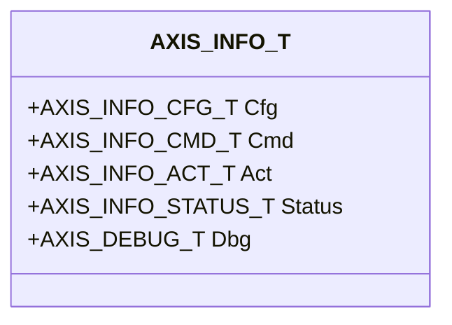

## 1. Kiến trúc biến hệ thống trục xung (Pulse Axis Variables)

Khi phát xung tốc độ cao trực tiếp từ CPU PLC Wecon (dòng ngõ ra Transistor), hệ thống tự động khởi tạo cấu trúc biến toàn cục định nghĩa sẵn mang tên **`AXIS_INFO_T`** cho từng trục. Người lập trình có thể truy cập trực tiếp các biến thành viên này để giám sát dữ liệu và gỡ lỗi mà không cần phải gọi nhiều khối hàm phụ trợ.

### Bảng ánh xạ phần cứng ngõ ra xung và chiều:
- **Local ID = 0:** Cặp chân xung/chiều `Y0 / Y1`
- **Local ID = 1:** Cặp chân xung/chiều `Y2 / Y3`
- **Local ID = 2:** Cặp chân xung/chiều `Y4 / Y5`
- **Local ID = 3:** Cặp chân xung/chiều `Y6 / Y7`

---

## 2. Cấu trúc dữ liệu chi tiết AXIS_INFO_T

Cấu trúc biến trục được phân tách thành 5 nhóm dữ liệu chức năng:

### 2.1. Nhóm Cấu hình (Cfg - Axis Configuration)
| Tên biến | Kiểu dữ liệu | Chức năng (Chỉ đọc - Read Only) |
| :--- | :---: | :--- |
| **wAxisID** | WORD | Số hiệu định danh của trục logic. |
| **wVersion** | WORD | Phiên bản firmware quản lý trục. |
| **wAxisType** | WORD | Kiểu trục (0: Bus Servo, 1: Bus Encoder, v.v.). |
| **nEtherCATNo** | DINT | Số hiệu thứ tự của trục trên mạng EtherCAT. |
| **nLocalID** | DINT | ID trục xung nội bộ phần cứng: `0` (Y0/Y1), `1` (Y2/Y3), `2` (Y4/Y5), `3` (Y6/Y7). |
| **bVirtualAxis** | BOOL | Cờ xác định trục là trục ảo (`TRUE`) hay trục vật lý (`FALSE`). |

### 2.2. Nhóm Lệnh phát đi (Cmd - Command Setpoints)
| Tên biến | Kiểu dữ liệu | Chức năng |
| :--- | :---: | :--- |
| **fSetPosition** | LREAL | Tọa độ đích cài đặt hiện thời đang được phát lệnh. |
| **fSetVelocity** | LREAL | Vận tốc cài đặt hiện thời đang được phát lệnh. |
| **fSetAcceleration**| LREAL | Gia tốc cài đặt hiện thời. |
| **fSetDeceleration**| LREAL | Gia tốc giảm tốc cài đặt hiện thời. |
| **fSetJerk** | LREAL | Độ giật S-curve cài đặt. |
| **nLocalAxisSetPos** | DINT | Tổng số xung phát lệnh nguyên bản của trục nội bộ. |

### 2.3. Nhóm Hồi tiếp thực tế (Act - Actual Feedback Values)
| Tên biến | Kiểu dữ liệu | Chức năng |
| :--- | :---: | :--- |
| **fActPosition** | LREAL | Vị trí hồi tiếp thực tế hiện tại của cơ cấu. |
| **fActVelocity** | LREAL | Vận tốc quay thực tế đo được từ Encoder. |
| **fFollowPos** | LREAL | Độ lệch bám vị trí (Following Error = SetPos - ActPos). |
| **nLocalAxisActPos** | DINT | Số xung thực tế đọc về từ bộ đếm tốc độ cao HSC. |
| **nLocalAxisActFrequency**| DINT | Tần số phát xung thực tế đo được thời gian thực. |

### 2.4. Nhóm Trạng thái logic (Status - Bit Indicators)
| Tên biến | Kiểu dữ liệu | Chức năng |
| :--- | :---: | :--- |
| **wAxisState** | WORD | Trạng thái máy trạng thái PLCopen hiện thời (StandStill, DiscreteMotion...). |
| **wAxisError** | DWORD | Mã lỗi hiện tại của trục (0 nếu bình thường). |
| **bPowerState** | BOOL | Báo trạng thái Servo ON đang sẵn sàng. |
| **bphLimit** | BOOL | Tín hiệu chạm công tắc hành trình giới hạn dương phần cứng. |
| **bnhLimit** | BOOL | Tín hiệu chạm công tắc hành trình giới hạn âm phần cứng. |
| **bHomeState** | BOOL | Tín hiệu công tắc cảm biến điểm gốc (Origin/Home). |
| **bPsLimit** | BOOL | Báo chạm giới hạn phần mềm chiều dương (Software Positive Limit). |
| **bnsLimit** | BOOL | Báo chạm giới hạn phần mềm chiều âm (Software Negative Limit). |
| **bTarDir** | BOOL | Chiều chuyển động mục tiêu (`FALSE`: Thuận, `TRUE`: Nghịch). |

### 2.5. Nhóm Gỡ lỗi bằng tay (Dbg - Axis Debugging Controls)
| Tên biến | Kiểu dữ liệu | Chức năng điều khiển gỡ lỗi |
| :--- | :---: | :--- |
| **bAxisDebug** | BOOL | Công tắc bật chế độ gỡ lỗi trực tiếp trên giao diện phần mềm. |
| **bPower** | BOOL | Công tắc cưỡng bức Servo ON/OFF. |
| **bStop** | BOOL | Nút kích hoạt dừng trục khẩn cấp. |
| **bReset** | BOOL | Nút kích hoạt xóa lỗi trục. |
| **bJogP / bJogN** | BOOL | Nút bấm chạy JOG thuận (+) / JOG nghịch (-). |
| **bHome** | BOOL | Nút bấm kích hoạt chu trình tìm gốc cơ học. |
| **bAbsPos / bRelPos**| BOOL | Nút bấm chạy thử định vị tuyệt đối / tương đối. |
| **fPresetPosition**| LREAL | Tọa độ đích đặt trước để test định vị. |
| **fJogVelocity** | LREAL | Vận tốc chạy thử JOG. |
