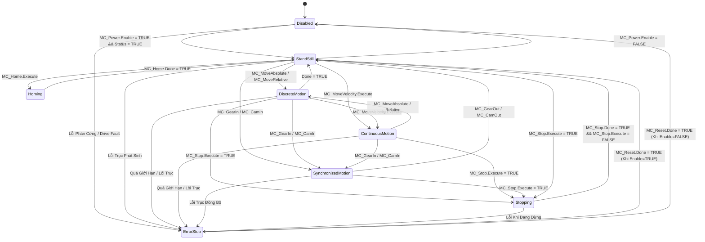
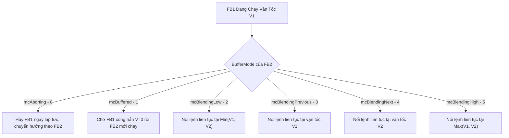

## 1. Sơ đồ trạng thái máy điều khiển trục đơn (Single Axis State Diagram)

### Các quy tắc chuyển đổi trạng thái bắt buộc:
1. Mọi trạng thái có thể chuyển về **ErrorStop** khi xuất hiện sự cố trên trục.
2. Mọi trạng thái chuyển về **Disabled** khi `MC_Power.Enable = FALSE` và trục không có lỗi.
3. Khi ở **ErrorStop**, trục chuyển về **StandStill** khi `MC_Reset.Done = TRUE`, `MC_Power.Enable = TRUE` và `MC_Power.Status = TRUE`.
4. Trục chuyển từ **Stopping** về **StandStill** chỉ khi `MC_Stop.Done = TRUE` **VÀ** `MC_Stop.Execute = FALSE`.

---

## 2. Cơ chế vùng đệm và nối tiếp lệnh: BufferMode

Khi kích hoạt liên tiếp hai khối lệnh chuyển động (Khối 1: FB1, Khối 2: FB2), tham số **BufferMode** trên FB2 quyết định hành vi tiếp quản trục:

### Chi tiết 6 chế độ BufferMode:
1. **mcAborting (Chế độ 0 - Mặc định):** Lệnh FB2 kích hoạt sẽ ngắt quyền ngay lập tức của FB1. Vận tốc và tọa độ đích chuyển hướng theo FB2 tức thì.
2. **mcBuffered (Chế độ 1):** FB2 xếp hàng chờ. FB1 chạy đến đích hoàn toàn và giảm tốc về 0 (V=0), ngay lập tức FB2 được kích hoạt mà không bị trễ thời gian chu kỳ quét PLC.
3. **mcBlendingLow (Chế độ 2):** Trục không dừng lại tại ranh giới giữa 2 khối lệnh mà chạy lướt qua vị trí tiếp giáp với vận tốc chuyển tiếp bằng `Min(V1, V2)`.
4. **mcBlendingPrevious (Chế độ 3):** Trục chạy qua điểm tiếp giáp với vận tốc duy trì chính xác bằng vận tốc của khối lệnh trước (V1).
5. **mcBlendingNext (Chế độ 4):** Trục chạy qua điểm tiếp giáp với vận tốc của khối lệnh sau (V2).
6. **mcBlendingHigh (Chế độ 5):** Trục chạy qua điểm tiếp giáp với vận tốc bằng `Max(V1, V2)`.

---

## 3. Chế độ vẽ cung tròn: Arc Mode (CircMode)

| Chế độ (`CircMode`) | Tên gọi | Cách thức xác định cung tròn | Ràng buộc kỹ thuật |
| :---: | :--- | :--- | :--- |
| **0** | **Border (3 điểm biên)** | Điểm bắt đầu $\to$ Điểm phụ `AuxPoint` $\to$ Điểm kết thúc `EndPoint`. | Góc ôm cung tròn bắt buộc phải nhỏ hơn `2π`. |
| **1** | **Circle Center (Tâm tròn)**| Điểm bắt đầu $\to$ Tâm đường tròn `AuxPoint` $\to$ Điểm kết thúc. Chọn chiều quay `CW` hoặc `CCW`. | Góc không được đúng bằng `π`; góc ôm nhỏ hơn `2π`. |
| **2** | **Diameter (Vectơ pháp tuyến)**| Điểm bắt đầu, điểm kết thúc và vectơ pháp tuyến vuông góc với mặt phẳng chứa cung tròn. | Phải tính toán vectơ vuông góc với mặt phẳng cung tròn; chiều dài vectơ bằng bán kính. |
