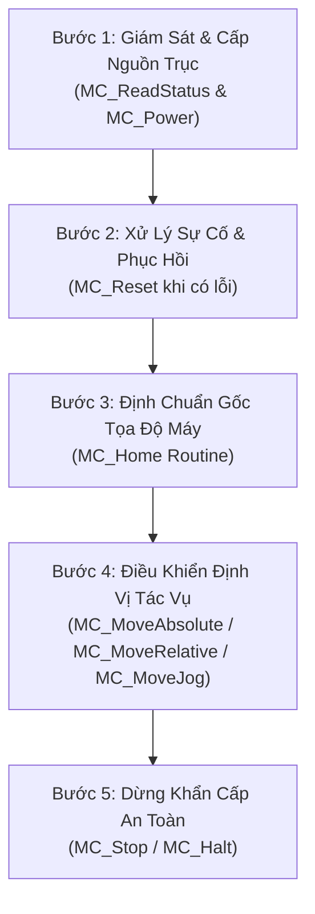

## Khung tuần tự 5 bước chuẩn hóa bài giảng

Trong công tác giảng dạy tự động hóa và đào tạo kỹ sư lập trình Motion Control, việc xây dựng cấu trúc chương trình theo một quy trình tuần tự chặt chẽ là chìa khóa giúp học viên không bị rối logic và kiểm soát hoàn toàn các trạng thái lỗi phần cứng:



---

## Mã nguồn mẫu hoàn chỉnh bằng ngôn ngữ Structured Text (ST)

```pascal
// ====================================================================
// CHƯƠNG TRÌNH ĐIỀU KHIỂN VỊ TRÍ TRỤC ĐƠN CHUẨN PLCOPEN TRÊN WECON LX6V
// ====================================================================

// --------------------------------------------------------------------
// BƯỚC 1: ĐỌC TRẠNG THÁI VÀ CẤP NGUỒN PHẦN MỀM CHO TRỤC SỐ 0
// --------------------------------------------------------------------
fb_ReadStatus(
    Axis                := 0,
    Enable              := TRUE,                 // Quét liên tục mỗi chu kỳ scan
    Valid               => bStatusValid,
    StandStill          => bAxisStandStill,      // Trục đứng yên sẵn sàng
    ErrorStop           => bAxisErrorStop,       // Trục bị lỗi dừng
    Disabled            => bAxisDisabled         // Trục chưa bật nguồn
);

fb_Power(
    Axis                := 0,
    Enable              := bServoOnCmd,          // Tín hiệu nút nhấn bật Servo từ HMI
    EnablePositive      := TRUE,                 // Cho phép quay chiều thuận
    EnableNegative      := TRUE,                 // Cho phép quay chiều nghịch
    Status              => bServoReady,          // Báo Servo đã ON thành công
    Error               => bPowerErr,
    ErrorID             => dwPowerErrID
);

// --------------------------------------------------------------------
// BƯỚC 2: RESET XÓA LỖI NẾU TRỤC RƠI VÀO ERRORSTOP
// --------------------------------------------------------------------
fb_Reset(
    Axis                := 0,
    Execute             := bResetCmd AND bAxisErrorStop, // Kích hoạt cạnh lên khi có lỗi
    Done                => bResetDone,
    Error               => bResetErr
);

// --------------------------------------------------------------------
// BƯỚC 3: QUY TRÌNH QUÉT TÌM GỐC CƠ HỌC (HOMING)
// --------------------------------------------------------------------
fb_Home(
    Axis                := 0,
    Execute             := bHomeCmd AND bAxisStandStill, // Chỉ tìm gốc khi trục đang StandStill
    Position            := 0.0,                          // Tọa độ áp đặt sau khi bắt được gốc
    BufferMode          := 0,                            // mcAborting
    Done                => bHomeDone,                    // Báo hoàn tất tìm gốc
    Busy                => bHomeBusy
);

// --------------------------------------------------------------------
// BƯỚC 4: CHẠY ĐỊNH VỊ VỊ TRÍ TUYỆT ĐỐI (MOVE ABSOLUTE)
// --------------------------------------------------------------------
fb_MoveAbs(
    Axis                := 0,
    Execute             := bStartMoveCmd AND bAxisStandStill AND bHomeDone, // Đã Home mới cho chạy
    Position            := 500.0,                        // Vị trí đích: 500.0 mm
    Velocity            := 100.0,                        // Vận tốc: 100 mm/s
    Acceleration        := 500.0,                        // Gia tốc tăng: 500 mm/s^2
    Deceleration        := 500.0,                        // Gia tốc giảm: 500 mm/s^2
    Jerk                := 1500.0,                       // Độ giật mượt đường cong S
    BufferMode          := 0,                            // mcAborting
    Done                => bMoveAbsDone,                 // Báo đã đến đích chính xác
    Busy                => bMoveAbsBusy
);

// --------------------------------------------------------------------
// BƯỚC 5: HÃM DỪNG AN TOÀN KHI NHẤN NÚT DỪNG KHẨN CẤP (E-STOP)
// --------------------------------------------------------------------
fb_Stop(
    Axis                := 0,
    Execute             := bEmergencyStopBtn,            // Mức TRUE duy trì khi nút ấn E-Stop kích hoạt
    Deceleration        := 2000.0,                       // Hãm gấp an toàn
    Jerk                := 5000.0,
    Done                => bStopDone,
    Busy                => bStopBusy
);
```

---

## Các lưu ý sư phạm quan trọng khi hướng dẫn học viên thực hành

1. **Khóa liên động an toàn (Interlock):** Luôn yêu cầu học viên kiểm tra biến `bHomeDone` trước khi cho phép bấm nút chạy tự động (`MoveAbsolute`), ngăn chặn tình trạng trục đâm kịch cữ cơ khí do chưa biết điểm 0 tọa độ máy.
2. **Hiển thị mã lỗi chuẩn:** Khai báo biến `dwErrorID` lên màn hình cảm ứng HMI dưới định dạng hiển thị số **HEX** (ví dụ: `16#00400007`) để học sinh tra cứu trực tiếp bảng mã lỗi của nhà sản xuất.
3. **Phân biệt `MC_Stop` và `MC_Halt`:** Giải thích rõ tại sao nút dừng khẩn cấp phải dùng `MC_Stop` (khóa cứng trạng thái Stopping) thay vì `MC_Halt` (cho phép bị lệnh khác ghi đè).
