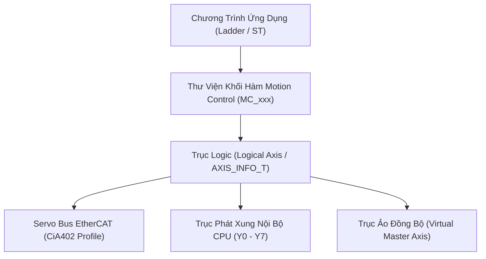

## Giới thiệu Chương 08: Motion Control

Chương **08 Motion Control** trong tài liệu hướng dẫn phần mềm **PLC Editor 2** dành cho các dòng PLC hiệu năng cao **WECON LX6V / LX6A500** cung cấp hệ thống tập lệnh và khối hàm điều khiển chuyển động theo tiêu chuẩn quốc tế **PLCopen (Motion Control Part 1, Part 2 & Part 4)**.

Kiến trúc này cho phép điều khiển linh hoạt từ các ứng dụng đơn trục (Single-axis), đồng bộ trục chủ - tớ (Master - Slave) bằng Cam và Gear điện tử, cho đến nội suy đa trục phức tạp (Axis Group) cho các hệ thống máy công cụ CNC, máy đóng gói và Robot công nghiệp.

---

## Cấu trúc 11 Phân mục Kỹ thuật trong Chương 08

Hệ thống tài liệu Chương 08 của hãng WECON được chuẩn hóa thành 11 phân mục kỹ thuật chi tiết:

1. **[8.01 Management Function Blocks for Single-axis Motion Control](./8.01-management-function-blocks.mdx):** 13 khối hàm quản trị trục đơn (Cấp nguồn, đọc trạng thái, xóa lỗi, đặt vị trí, bắt vị trí ngắt TouchProbe).
2. **[8.02 Motion Function Blocks for Single-axis Motion Control](./8.02-motion-function-blocks.mdx):** 7 khối hàm chuyển động trục đơn (Dừng khống chế, về gốc, tạm dừng, định vị tuyệt đối, tương đối, gia số).
3. **[8.03 Management Function Blocks for Multi-axis Motion Control](./8.03-management-fb-multi-axis.mdx):** 3 khối hàm quản trị bảng Cam điện tử (Chọn bảng cam, sinh bảng cam động, lưu trữ bảng cam).
4. **[8.04 Motion Function Block for Multi-axis Motion Control](./8.04-motion-fb-multi-axis.mdx):** 5 khối hàm chuyển động đồng bộ Cam và Gear điện tử (MC_CamIn, MC_CamOut, MC_GearIn, MC_GearOut, MC_GearInPos).
5. **[8.05 Management Functions of Axis Group Motion Control](./8.05-management-functions-axis-group.mdx):** 10 khối hàm quản trị nhóm trục (Bật/tắt nhóm, xóa lỗi, đọc trạng thái nhóm, thêm/tách trục).
6. **[8.06 Axis Group Motion Function Blocks](./8.06-axis-group-motion-fb.mdx):** 8 khối hàm nội suy nhóm trục (Nội suy đường thẳng Linear, nội suy cung tròn Circular 3 chế độ, chạy trực tiếp Direct).
7. **[8.07 Other Special FB](./8.07-other-special-fb.mdx):** 10 khối hàm đặc biệt (Chạy JOG, điều khiển vận tốc liên tục, tổng hợp 2 trục chủ, điều khiển lực căng Torque, các chế độ Bus CiA402 CSV/PV/PT/PP).
8. **[8.08 SDO Instruction](./8.08-sdo-instruction.mdx):** Lệnh đọc/ghi từ điển đối tượng SDO qua mạng truyền thông thời gian thực EtherCAT.
9. **[8.09 Built-in Variables of Pulse Axis System](./8.09-built-in-variables-pulse-axis.mdx):** Bảng biến hệ thống toàn cục định nghĩa sẵn cho trục xung phần cứng Y0-Y7 (`Cfg`, `Cmd`, `Act`, `Status`, `Dbg`).
10. **[8.10 Others](./8.10-others.mdx):** Sơ đồ chuyển đổi trạng thái PLCopen (Single Axis & Axis Group), 3 chế độ nội suy cung tròn CircMode, các chế độ đệm lệnh BufferMode (mcAborting, mcBuffered, mcBlending).
11. **[8.11 Error Code Cross-reference Table](./8.11-error-code-table.mdx):** Bảng tra cứu đối chiếu toàn diện 154 mã lỗi chuẩn hãng theo 12 nhóm sự cố kèm phương án khắc phục.
12. **[8.12 Khung chương trình chuẩn phục vụ giảng dạy](./8.12-chuong-trinh-mau-giang-day.mdx):** Khung lập trình mẫu 5 bước tuần tự chuẩn quốc tế bằng ngôn ngữ Structured Text (ST).
