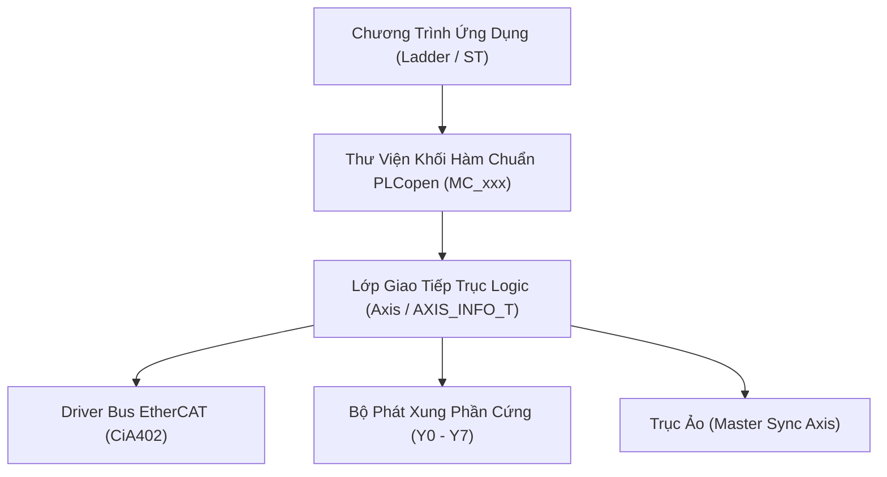
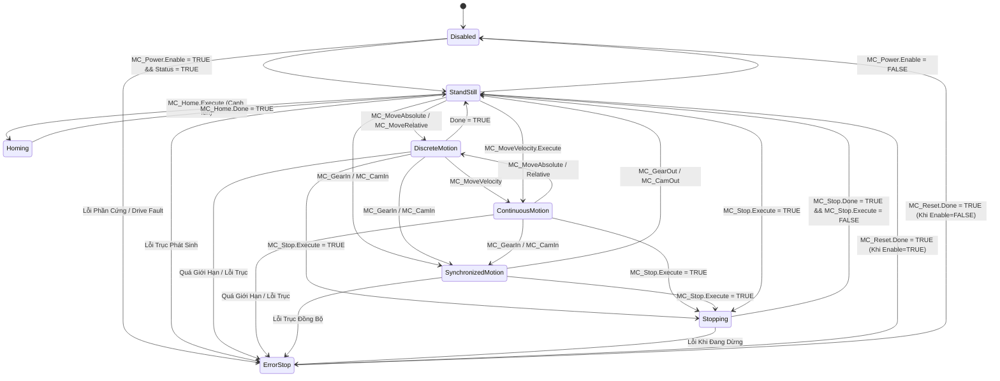

## CHƯƠNG 1: KIẾN TRÚC MOTION CONTROL & MÔ HÌNH TRẠNG THÁI PLCOPEN

### 1.1. Kiến Trúc Trục Logic (Logical Axis Concept)
Trong môi trường WECON PLC Editor 2, hệ thống điều khiển vị trí không can thiệp trực tiếp vào phần cứng vật lý ở tầng dưới cùng mà quản lý thông qua khái niệm **Trục Logic (Axis Reference)**:
- **Trục Bus EtherCAT (CiA402 Profile):** Kết nối Servo thông qua mạng truyền thông thời gian thực EtherCAT.
- **Trục Phát Xung Nội Bộ (Local Pulse Axis):** Sử dụng các ngõ ra transistor tốc độ cao tích hợp trên CPU PLC (Y0/Y1: ID 0, Y2/Y3: ID 1, Y4/Y5: ID 2, Y6/Y7: ID 3).
- **Trục Ảo (Virtual Axis):** Trục không liên kết phần cứng vật lý, thường dùng làm Trục Chủ (Master Axis) cho cấu hình Cam hoặc Gear điện tử.

### 1.2. Mô Hình Trạng Thái Trục Đơn (Single-Axis State Machine)
Mọi hành vi chuyển động của từng trục phải tuân thủ nghiêm ngặt biểu đồ trạng thái chuẩn PLCopen Part 1/Part 2 do WECON định nghĩa:

> [!IMPORTANT]
> **Quy tắc sư phạm cốt lõi khi giảng dạy:**
> 1. Trục chỉ có thể nhận lệnh chuyển động (`MC_Move...`, `MC_Home`) khi đang ở trạng thái **StandStill**.
> 2. Khi đang ở trạng thái **Stopping**, trục bị khóa hoàn toàn, mọi lệnh chuyển động khác đều bị từ chối cho đến khi `MC_Stop.Done = TRUE` **VÀ** tín hiệu `MC_Stop.Execute` hạ xuống mức `FALSE`.
> 3. Khi trục rơi vào **ErrorStop**, việc duy nhất cần làm là khắc phục nguyên nhân sự cố rồi kích hoạt `MC_Reset`.

---
