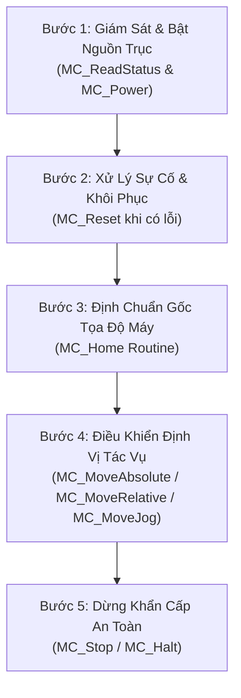

## CHƯƠNG 11: KHUNG CHƯƠNG TRÌNH CHUẨN (STANDARD WORKFLOW) PHỤC VỤ GIẢNG DẠY

Để bài giảng đạt hiệu quả cao nhất và tránh lỗi lập trình cho học viên, toàn bộ chương trình điều khiển vị trí một trục nên được tổ chức theo 5 bước tuần tự chuẩn hóa:



### Mã Mẫu Bằng Ngôn Ngữ Structured Text (ST) / Nguyên Lý Bậc Thang (Ladder)

```pascal
// ====================================================================
// BƯỚC 1: ĐỌC TRẠNG THÁI VÀ CẤP NGUỒN CHO TRỤC SỐ 0
// ====================================================================
fb_ReadStatus(
    Axis        := 0,
    Enable      := TRUE,
    Valid       => bStatusValid,
    StandStill  => bAxisStandStill,
    ErrorStop   => bAxisErrorStop,
    Disabled    => bAxisDisabled
);

fb_Power(
    Axis            := 0,
    Enable          := bServoOnCmd,         // Tín hiệu nút nhấn đóng nguồn từ HMI
    EnablePositive  := TRUE,
    EnableNegative  := TRUE,
    Status          => bServoReady,
    Error           => bPowerErr,
    ErrorID         => dwPowerErrID
);

// ====================================================================
// BƯỚC 2: RESET LỖI NẾU TRỤC RƠI VÀO ERRORSTOP
// ====================================================================
fb_Reset(
    Axis    := 0,
    Execute := bResetCmd AND bAxisErrorStop,
    Done    => bResetDone,
    Error   => bResetErr
);

// ====================================================================
// BƯỚC 3: QUY TRÌNH VỀ GỐC CƠ HỌC (HOMING)
// ====================================================================
fb_Home(
    Axis        := 0,
    Execute     := bHomeCmd AND bAxisStandStill,
    Position    := 0.0,                     // Tọa độ gán sau khi bắt được gốc
    BufferMode  := 0,                       // mcAborting
    Done        => bHomeDone,
    Busy        => bHomeBusy
);

// ====================================================================
// BƯỚC 4: CHẠY ĐỊNH VỊ VỊ TRÍ TUYỆT ĐỐI (MOVE ABSOLUTE)
// ====================================================================
fb_MoveAbs(
    Axis         := 0,
    Execute      := bStartMoveCmd AND bAxisStandStill AND bHomeDone,
    Position     := 500.0,                  // Đích đến: 500.0 mm
    Velocity     := 100.0,                  // Vận tốc: 100 mm/s
    Acceleration := 500.0,                  // Gia tốc: 500 mm/s^2
    Deceleration := 500.0,                  // Độ hãm: 500 mm/s^2
    Jerk         := 1000.0,                 // Độ giật mượt
    BufferMode   := 0,
    Done         => bMoveAbsDone,
    Busy         => bMoveAbsBusy
);

// ====================================================================
// BƯỚC 5: HÃM DỪNG AN TOÀN KHI NHẤN NÚT STOP
// ====================================================================
fb_Stop(
    Axis         := 0,
    Execute      := bEmergencyStopBtn,      // Giữ mức TRUE khi nút dừng được kích hoạt
    Deceleration := 2000.0,                 // Hãm gấp
    Jerk         := 5000.0,
    Done         => bStopDone,
    Busy         => bStopBusy
);
```

---

> [!TIP]
> **Khuyến nghị cho bài thực hành tại xưởng / phòng Lab:**
> 1. Luôn hướng dẫn học sinh kiểm tra biến `bHomeDone` trước khi cho phép bấm nút chạy tự động (`MoveAbsolute`), tránh tình trạng servo đâm kịch cữ cơ khí khi chưa xác lập được mốc 0.
> 2. Khai báo biến lỗi `dwErrorID` lên màn hình HMI dưới dạng hiển thị số HEX (ví dụ: `16#00400007`) để sinh viên tập thói quen tra cứu trực tiếp bảng mã lỗi của nhà sản xuất WECON.
