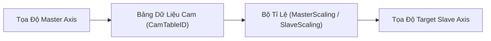

## CHƯƠNG 4: ĐIỀU KHIỂN ĐA TRỤC - CAM & GEAR ĐIỆN TỬ (8.03 & 8.04)

Hệ thống cho phép liên kết động học giữa một **Trục Chủ (Master Axis)** và một hoặc nhiều **Trục Tớ (Slave Axis)**.

### 4.1. Khớp Nối Bánh Răng Điện Tử (Electronic Gear - E-GEAR)
Cơ chế khớp nối tỉ số truyền số học giữa Master và Slave:
```text
Vận tốc Slave = Vận tốc Master * (RatioNumerator / RatioDenominator)
```

1. **MC_GEARIN:** Khớp nối Master và Slave theo tỉ số truyền:
   - `RatioNumerator` (DINT): Tử số tỉ lệ bánh răng.
   - `RatioDenominator` (DINT): Mẫu số tỉ lệ bánh răng (khác 0).
   - `Acceleration`, `Deceleration`: Giới hạn gia tốc khi Slave tăng tốc để bám kịp Master.
   - Ngõ ra `InGear` báo mức `TRUE` khi Slave đã đồng bộ hoàn toàn vận tốc với Master.
2. **MC_GEAROUT:** Tách Slave ra khỏi Master. Sau khi gọi lệnh, Slave chuyển từ `SynchronizedMotion` sang `ContinuousMotion` và duy trì vận tốc tại thời điểm tách cho đến khi có lệnh dừng.
3. **MC_GEARINPOS:** Khớp nối bánh răng với yêu cầu đồng bộ chính xác cả về **Góc Pha Vị Trí (Position Phase)** tại một vị trí định trước của Master và Slave.

---

### 4.2. Cam Điện Tử (Electronic Cam - E-CAM)
Mô phỏng cơ cấu cam cơ khí thông qua bảng tra cứu toán học hoặc đa thức nội suy bậc 5.



#### Các Khối Hàm Quản Trị & Vận Hành Cam:
1. **MC_CAMTABLESELECT (8.03):** Nạp và lựa chọn bảng cam từ bộ nhớ:
   - `Periodic` (BOOL): Chạy lặp lại tuần hoàn (`TRUE`) hay chạy 1 lần (`FALSE`).
   - `CamTableID`: Mã định danh bảng dữ liệu cam.
2. **MC_GENERATECAMTABLE (8.03):** Tự động sinh bảng cam nội suy trực tiếp trong runtime PLC.
3. **MC_SAVECAMTABLE (8.03):** Lưu dữ liệu cam vào bộ nhớ không bay màu (Flash/Non-volatile).
4. **MC_CAMIN (8.04):** Bắt đầu đóng khớp nối Cam:
   - `MasterScaling` (LREAL), `SlaveScaling` (LREAL): Hệ số nhân tỉ lệ hành trình.
   - `MasterStartDistance`: Khoảng cách Master chạy trước khi bắt đầu tính toán Cam.
   - `MasterSyncPosition`: Điểm Master bắt đầu đồng bộ.
   - `StartMode`: Chế độ bắt đầu (Tuyệt đối hoặc Tương đối).
   - `InSync` (BOOL): Báo `TRUE` khi trục Slave đã ăn khớp hoàn toàn với bảng Cam.
   - `EndOfProfile` (BOOL): Xung báo hiệu kết thúc một chu kỳ Cam.
5. **MC_CAMOUT (8.04):** Thoát khỏi chế độ Cam điện tử.

---
