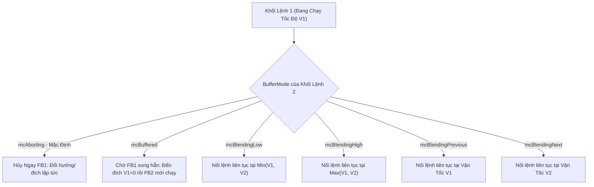

## CHƯƠNG 9: CƠ CHẾ ĐỆM LỆNH (BUFFERMODE) & NỘI SUY CUNG TRÒN (8.10 OTHERS)

Trong các máy tự động tốc độ cao (như máy dán nhãn, máy đóng gói liên tục), nếu mỗi lần chạy xong một đoạn vị trí mà trục phải dừng hẳn về vận tốc 0 rồi mới chạy tiếp đoạn sau thì máy sẽ bị giật và giảm năng suất. Tham số `BufferMode` giải quyết bài toán này:

### 9.1. Các Chế Độ Vùng Đệm (BufferMode)

1. **mcAborting (Chế độ 0 - Mặc định):** Lệnh mới kích hoạt sẽ lập tức ngắt ngang lệnh cũ. Trục bỏ qua đích cũ và chuyển hướng theo thông số của lệnh mới ngay tức thì.
2. **mcBuffered (Chế độ 1):** Lệnh mới xếp hàng chờ. Lệnh cũ chạy đến nơi, giảm tốc về đúng vị trí đích (`V=0`), ngay lập tức lệnh mới được kích hoạt mà không bị trễ thời gian chu kỳ quét.
3. **mcBlendingLow (Chế độ 2):** Trục không dừng lại tại ranh giới giữa 2 khối lệnh mà chạy lướt qua vị trí tiếp giáp với vận tốc bằng `Min(V1, V2)`.
4. **mcBlendingPrevious (Chế độ 3):** Trục chạy qua điểm tiếp giáp với vận tốc duy trì chính xác bằng vận tốc của khối lệnh trước (`V1`).
5. **mcBlendingNext (Chế độ 4):** Trục chạy qua điểm tiếp giáp với vận tốc của khối lệnh sau (`V2`).
6. **mcBlendingHigh (Chế độ 5):** Trục chạy qua điểm tiếp giáp với vận tốc bằng `Max(V1, V2)`.

---
