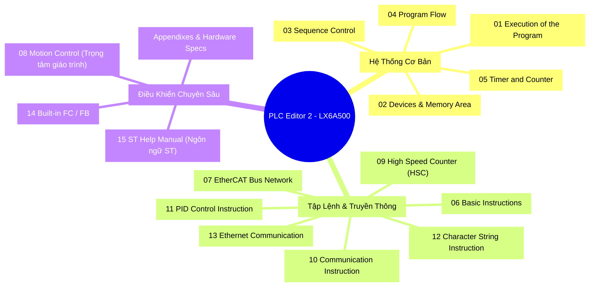

## Giới thiệu tổng quan hệ thống PLC Wecon LX6V / LX6A500

Dòng controller **WECON LX6V / LX6A500** là thế hệ PLC điều khiển công nghiệp hiệu năng cao của hãng WECON, hỗ trợ lập trình bằng phần mềm hiện đại **PLC Editor 2** tuân thủ hoàn toàn tiêu chuẩn quốc tế **IEC 61131-3** và tiêu chuẩn chuyển động **PLCopen**.

Hệ thống kết hợp khả năng xử lý logic tốc độ cao, điều khiển bus truyền thông thời gian thực **EtherCAT** lên tới hàng chục trục servo đồng bộ, cùng các ngõ ra phát xung nội bộ tốc độ cao trên phần cứng CPU.

---

## Bản đồ điều hướng tài liệu kỹ thuật (Navigation Map)

Hệ thống tài liệu hướng dẫn sử dụng của WECON được cấu trúc thành các chương chuyên đề bám sát cây thư mục Navigation chính thức của hãng:

---

## Chi tiết các chương chuyên đề

1. **[01 Execution of the Program](./01-execution-of-program.mdx):** Cơ chế quét vòng lặp (Scan Cycle), thứ tự thực thi chương trình và xử lý ngắt.
2. **[02 Devices](./02-devices.mdx):** Bản đồ vùng nhớ thiết bị (X, Y, M, S, SM, T, C, D, R, SD) và cách đánh địa chỉ.
3. **[03 Sequence Control](./03-sequence-control.mdx):** Điều khiển tuần tự và ngôn ngữ biểu đồ chức năng tuần tự (SFC / STL).
4. **[04 Program Flow](./04-program-flow.mdx):** Cấu trúc rẽ nhánh, vòng lặp điều kiện, lệnh gọi chương trình con (CALL, CJ, FOR/NEXT).
5. **[05 Timer and Counter](./05-timer-and-counter.mdx):** Bộ định thời gian (Timer) và bộ đếm sự kiện (Counter) thường và tốc độ cao.
6. **[06 Basic instructions](./06-basic-instructions.mdx):** Tập lệnh logic tiếp điểm cơ bản (LD, LDI, AND, ANI, OR, ORI, OUT, SET, RST).
7. **[07 EtherCAT](./07-ethercat.mdx):** Hướng dẫn cấu hình mạng truyền thông thời gian thực EtherCAT và quét trạm Servo Drive.
8. **[08 Motion Control](./08-motion-control/index.mdx):** **Chuyên mục trọng tâm** - Toàn bộ 11 phân mục điều khiển chuyển động đơn trục, đa trục (Cam/Gear), nhóm trục nội suy và 154 mã lỗi PLCopen.
9. **[09 High Speed Counter](./09-high-speed-counter.mdx):** Bộ đếm xung tốc độ cao phần cứng CPU (HSC) dùng cho Encoder hồi tiếp vị trí.
10. **[10 Communication Instruction](./10-communication-instruction.mdx):** Lệnh truyền thông nối tiếp RS-485 / RS-422 qua Modbus RTU / ASCII.
11. **[11 PID Control Instruction](./11-pid-control-instruction.mdx):** Thuật toán điều khiển vòng kín PID nhiệt độ và áp suất với tính năng tự dò thông số (Auto-tuning).
12. **[12 Character String Instruction](./12-character-string-instruction.mdx):** Tập lệnh xử lý chuỗi ký tự ASCII, mã vạch và máy quét barcode.
13. **[13 Ethernet Communication](./13-ethernet-communication.mdx):** Truyền thông Ethernet mạng LAN: Modbus TCP, Socket TCP/IP, kết nối HMI và SCADA.
14. **[14 Built-in FC/FB](./14-builtin-fc-fb.mdx):** Các hàm chức năng (FC) và khối hàm (FB) tích hợp sẵn của phần mềm PLC Editor 2.
15. **[15 ST Help Manual](./15-st-help-manual.mdx):** Hướng dẫn lập trình ngôn ngữ văn bản có cấu trúc (Structured Text - ST) theo chuẩn IEC 61131-3.
16. **[Appendixes](./16-appendixes.mdx):** Phụ lục kỹ thuật, bảng đối chiếu thông số phần cứng giữa các dòng LX6V, LX6S và A500.
